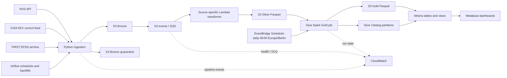

# ThreatFlow

ThreatFlow is a cybersecurity data engineering capstone that turns public vulnerability
intelligence into an explainable daily investigation queue. It combines:

- **NVD** — CVE descriptions, CVSS severity, CWE context, affected configurations, and
  modification history;
- **CISA KEV** — vulnerabilities with confirmed exploitation, remediation deadlines, and known
  ransomware use;
- **FIRST EPSS** — daily exploitation probability and percentile for each CVE.

The primary users are vulnerability-management, SOC, and threat-intelligence analysts. The main
output answers:

> Which vulnerabilities should be investigated first, based on severity, exploitation evidence,
> and probability?

ThreatFlow supports prioritisation and investigation. It does not contain an organisation's asset
inventory, installed versions, exposure, business criticality, or remediation state, so it does
not claim that a specific organisation is vulnerable.

## What the project delivers

- reproducible and idempotent ingestion of three public sources;
- immutable source evidence for replay and audit;
- source-specific validation and fail-closed handling of incomplete data;
- historical and incremental processing without silently losing NVD changes or EPSS dates;
- typed Parquet Silver datasets in S3;
- daily detail and summary Gold products built with Glue Spark;
- Glue Catalog and Athena views for analytics;
- Metabase dashboards with CVE search and drill-through;
- Airflow orchestration locally and EventBridge scheduling for AWS Gold;
- Terraform-managed AWS infrastructure and CloudWatch observability.

The local runtime is the orchestration and development control plane. Pipeline data is stored in
AWS S3; local PostgreSQL is reserved for Airflow and Metabase metadata. Unit tests remain
credential-free through local fixtures and stubbed AWS clients.

## Architecture and pipeline



### Processing flow

1. Airflow invokes source-specific Python services for daily ingestion or validated historical
   backfills. Airflow owns scheduling and dependencies; HTTP, parsing, validation, and persistence
   remain in application modules.
2. Exact accepted source bytes are stored immutably in S3 Bronze. Rejected source payloads are
   written under the isolated S3 quarantine prefix and fail the Airflow task. The durable NVD
   modified-window checkpoint is a conditionally updated S3 control object.
3. Source-specific transformations validate and publish typed Parquet to Silver. S3 events and
   SQS deliver committed Bronze objects to source-specific Lambda processors. Historical recovery
   uses the same bounded Airflow ingestion and AWS publication path.
4. A daily Glue Spark job resolves committed Silver inputs, builds the Gold detail and summary
   products, runs quality gates, and publishes a shared product commit last.
5. The same successful Gold run registers the exact `snapshot_date` and `run_id` locations in
   Glue Catalog. Athena views provide the serving contract used by Metabase.
6. CloudWatch dashboards, logs, alarms, queues, and DLQs expose pipeline failures, lag, and data
   volume.

## Data layers

### Bronze — immutable source evidence

Bronze preserves the exact bytes received from a source before analytical transformation. Objects
are content-addressed and identified by source plus SHA-256, for example:

```text
s3://<bronze-bucket>/bronze/source=nvd/sha256=<sha256>.json
s3://<bronze-bucket>/bronze/source=cisa_kev/sha256=<sha256>.json
s3://<bronze-bucket>/bronze/source=epss/sha256=<sha256>.csv.gz
s3://<bronze-bucket>/bronze/_quarantine/source=<source>/sha256=<sha256>.<extension>
```

The layer exists for audit, replay, parser changes, and investigation of upstream defects.
Accepted objects carry checksums and source metadata; NVD window manifests and Silver manifests
are commit markers. Syntactically invalid or implausibly incomplete input is retained only in the
quarantine prefix and is never promoted as a successful dataset.

### Silver — validated, typed source history

Silver converts source formats into compressed Parquet with stable schemas and source-effective
partitions:

| Dataset | Grain | Main partitioning | Important guarantees |
| --- | --- | --- | --- |
| `epss_scores` | One CVE score on one EPSS source date | `score_date=YYYY-MM-DD` | Unique CVE/date, score and percentile ranges, exact source date |
| `nvd_cve_windows` | CVEs observed in one committed NVD request window | mode and window identity | Complete pagination, deterministic window boundaries, newest `lastModified` wins |
| CISA KEV snapshots | One validated catalog snapshot/revision | snapshot kind and effective date | Declared-count validation, empty/truncated catalog rejection, revision lineage |

Every published partition has a manifest describing its inputs and output identity. Writers are
idempotent: an identical retry reuses committed output; conflicting content for the same identity
fails instead of overwriting data silently.

### Gold — analytics-ready data products

Gold answers a defined analyst question rather than copying all Silver columns. The first product
contains:

| Product | Grain | Purpose |
| --- | --- | --- |
| `vulnerability_priority_daily` | One prioritised CVE per `snapshot_date` | Explainable P1/P2/P3/WATCH investigation queue with NVD, KEV, and EPSS context |
| `vulnerability_priority_summary_daily` | One priority tier per `snapshot_date` | Daily KPI and trend totals for dashboards |

Gold is partitioned by `snapshot_date`; each immutable run is stored under its canonical
`run_id`, derived from the input fingerprint. Schema, uniqueness, allowed tiers, EPSS ranges, and
detail/summary reconciliation must pass before the final product commit is written.

Glue Catalog stores table and partition metadata, not copies of the Parquet data. Each committed
partition points to the exact S3 run directory. Athena external tables and version-controlled
views query those locations; Metabase queries the views rather than S3 directly.

Historical Gold can be rebuilt from available committed Silver history. A reconstructed snapshot
is explicitly labelled and does not claim complete historical NVD state unless that history has
been proven complete.

## Main resources

### Local runtime

| Resource | Responsibility |
| --- | --- |
| PostgreSQL 17 | Separate Airflow and Metabase metadata databases only; no pipeline business data |
| Airflow 3.1 LocalExecutor | Daily DAGs, manual backfill, retries, timeouts, pools, and task dependencies |
| Python application | Fetching, validation, S3 publication, AWS-backed checkpoints, and CLI tools |
| Local temporary directories | Test fixtures and bounded Lambda/Glue-compatible transformation scratch space only |
| Metabase | Dashboards, filters, CVE search, and drill-through |

### AWS development runtime

| AWS resource | Responsibility |
| --- | --- |
| S3 Bronze, Silver, Gold, and Athena-results buckets | Immutable source objects, Parquet layers, committed products, and query results |
| SQS queues and DLQs | Decoupled, retryable delivery of matching Bronze events |
| ECR and Lambda | Immutable transformation images and source-specific Silver processing |
| Glue Spark | Daily multi-source Gold transformation and quality gates |
| Glue Data Catalog | External table definitions and exact committed partitions |
| Athena workgroup and views | Governed SQL serving layer for Metabase |
| EventBridge Scheduler and rules | Daily Gold invocation and terminal-state failure capture |
| CloudWatch | Logs, alarms, pipeline health, freshness, queue state, and data-volume dashboards |
| IAM | Separate least-privilege roles and service identities |
| Terraform | Reproducible infrastructure definitions and drift detection |

## Technology choices

| Technology | Why it is used |
| --- | --- |
| Python, Pydantic, HTTPX | Typed, testable source clients and validation with a small application surface |
| Airflow | Explicit schedules, recovery DAGs, retries, pools, and operational visibility without putting business logic in DAG files |
| S3 | Durable and inexpensive immutable object storage for replayable lake layers |
| Parquet and PyArrow | Typed columnar storage, compression, and efficient analytical scans |
| Lambda, SQS, ECR | Bounded event-driven Silver processing with durable retry and immutable runtime images |
| Glue Spark | Distributed multi-input transformation and quality checks for daily Gold products |
| Glue Catalog and Athena | Serverless metadata and SQL over S3 without loading a separate warehouse |
| Metabase | Lightweight open-source BI, dashboard filters, drill-through, and Athena connectivity |
| Terraform | Reviewable and repeatable AWS resource, IAM, schedule, and monitoring configuration |
| CloudWatch | Native AWS logs, metrics, dashboards, and alarms |

Kafka, Kubernetes, and a continuously running Spark cluster are intentionally excluded: the
source cadence is daily or periodic, and the current capstone volume does not justify their
operational complexity.

### Gold failure notifications

The Terraform-managed Gold runtime sends three CloudWatch alarms to a dedicated SNS topic:

- terminal Glue states (`FAILED`, `TIMEOUT`, or `STOPPED`);
- a non-empty EventBridge Scheduler dead-letter queue;
- no successful Gold Glue heartbeat within the configured rolling window (26 hours by default).

Set `gold_alert_email` before applying the development Terraform environment, then confirm the
subscription from that mailbox. AWS does not deliver email notifications until confirmation.
The missing-success alarm has actions disabled while `gold_schedule_enabled=false`, avoiding a
false notification before the daily runtime is intentionally enabled. Terminal errors from a
manual smoke test remain alertable.

### Silver failure notifications

The Bronze-to-Silver observability module sends all NVD, CISA, and EPSS transformation alarms to
a dedicated SNS topic. Notifications cover an emitted processing failure, a source queue whose
oldest message exceeds the configured threshold, and a non-empty source DLQ. Recovery transitions
back to `OK` are also delivered. Set `silver_alert_email` before applying Terraform and confirm the
SNS subscription from that mailbox; unconfirmed email subscriptions receive no messages.

## Repository layout

```text
airflow/dags/                 orchestration only: schedules and task dependencies
analytics/                    PostgreSQL checks and Metabase/Athena SQL
docs/                         design, validation, governance, and runbooks
glue/                         AWS Glue job entry point
infra/                        Terraform modules and development environment
lambda/                       container entry points for Silver transformations
scripts/                      reproducible verification and release workflows
src/threatflow/ingestion/     source fetching, parsing, and completeness validation
src/threatflow/transformation/ Bronze-to-Silver transformations
src/threatflow/gold/          Gold build, publisher, Catalog, and Athena deployment
tests/                        unit, Airflow, integration, Spark, and Terraform tests
```

## Run the project locally

### Prerequisites

- Git;
- Docker Desktop or another Docker Engine with Compose v2;
- Python 3.12 or newer;
- [`uv`](https://docs.astral.sh/uv/);
- JDK 21 only when running local PySpark tests.

JDK 24 is not supported by the current local Spark/Parquet test runtime. AWS Glue supplies its
own managed runtime.

### 1. Clone and configure

```bash
git clone https://github.com/NataliaGurevich/threatflow-platform-capstone.git
cd threatflow-platform-capstone
cp .env.example .env
```

Edit `.env` and replace every required `replace-me` / `replace-with-...` value. At minimum set:

```text
THREATFLOW_POSTGRES_PASSWORD
AIRFLOW_ADMIN_PASSWORD
AIRFLOW_JWT_SECRET
METABASE_DB_PASSWORD
MB_ENCRYPTION_SECRET_KEY
MB_SESSION_SECRET_KEY
```

Generate independent random values rather than reusing one secret. For example:

```bash
openssl rand -hex 32
openssl rand -base64 32
```

Keep `.env` local; it is ignored by Git. `THREATFLOW_NVD_API_KEY` is optional but useful for
higher NVD API limits. Configure the Bronze and Silver bucket names plus the short-lived local
Airflow AWS profile paths before starting ingestion.

### 2. Install the development environment

```bash
uv sync --group dev
```

This installs the application, CLI entry points, test tools, and local PySpark dependency into
`.venv`.

### 3. Validate and start the stack

```bash
docker compose -f docker-compose.yml -f docker-compose.aws.yml config -q
docker compose -f docker-compose.yml -f docker-compose.aws.yml up -d --build
docker compose -f docker-compose.yml -f docker-compose.aws.yml ps
```

The one-shot services create the separate Airflow and Metabase metadata databases and initialise
Airflow before the long-running services start. No application-data database or local lake
directory is created. First startup can take several minutes.

Open:

- Airflow: <http://localhost:8080> — user `admin` by default and the password from
  `AIRFLOW_ADMIN_PASSWORD`;
- Metabase: <http://localhost:3000>;
- PostgreSQL: `localhost:5432`, for local service metadata only.

Check startup failures with:

```bash
docker compose ps
docker compose logs --tail=200 airflow-api-server airflow-scheduler airflow-dag-processor
docker compose logs --tail=200 metabase postgres
```

### 4. Run ingestion

In Airflow, unpause and trigger the required DAG:

| DAG | Default schedule (UTC) | Purpose |
| --- | --- | --- |
| `nvd_daily` | `0 3 * * *` | Fetch the next durable NVD modification window |
| `cisa_daily` | `0 4 * * *` | Synchronise and validate the current KEV catalog |
| `epss_daily` | `0 6 * * *` | Ingest a date-specific EPSS archive |
| `threat_intel_backfill` | manual | Validated historical loads and recovery |

Daily DAGs use `catchup=False`. Missed NVD coverage is recovered through the durable S3 checkpoint
and explicit modified-window backfill, not by relying on Airflow catchup. CISA is a current
catalog: selecting it in backfill performs one current `snapshot_sync`, not one fake historical
load per requested date.

Example manual backfill configuration, with inclusive dates:

```json
{
  "sources": ["nvd", "epss"],
  "start_date": "2025-01-01",
  "end_date": "2025-01-07",
  "nvd_mode": "published",
  "chunk_days": 7
}
```

Use `nvd_mode=modified` to recover later changes; `published` and `modified` have different source
semantics and are not interchangeable. Do not use a routine full backfill as a smoke test.

### 5. Run the reproducible verification

The capstone demo uses fixtures and disposable test resources; it does not call production APIs
or perform a historical backfill:

```bash
./scripts/run-capstone-demo.sh
```

If the local stack already contains ingested data, add `--with-running-stack` to run the
read-only analytical checks against it.

Useful individual checks are:

```bash
.venv/bin/python -m ruff check .
.venv/bin/python -m pytest -q
docker compose config -q
```

For local Spark tests, select JDK 21 and point Spark workers at the project interpreter:

```bash
export JAVA_HOME=$(/usr/libexec/java_home -v 21)
export PYSPARK_PYTHON="$PWD/.venv/bin/python"
export PYSPARK_DRIVER_PYTHON="$PWD/.venv/bin/python"
.venv/bin/python -m pytest -q tests/unit/test_gold_vulnerability_priority.py
```

### 6. Stop safely

```bash
docker compose -f docker-compose.yml -f docker-compose.aws.yml down
```

This stops containers and retains named PostgreSQL, Airflow-log, and Airflow-auth volumes. Do not
use `docker compose down -v` unless you explicitly intend to delete local persistent data.

## Deploy the AWS development path

AWS deployment is optional for running the local project. It requires Terraform, Docker Buildx,
AWS CLI, short-lived AWS credentials, globally unique bucket names, and review of the expected
AWS cost.

1. Authenticate with the intended deployment profile and verify the account:

   ```bash
   aws login --profile threatflow-deploy
   AWS_PROFILE=threatflow-deploy aws sts get-caller-identity
   ```

2. Create the ignored environment configuration:

   ```bash
   cp infra/environments/dev/terraform.tfvars.example \
      infra/environments/dev/terraform.tfvars
   ```

3. Replace all example account IDs, bucket names, image digests, and Glue artifact URIs. Keep
   schedules and event-source mappings disabled until their artifacts pass a manual smoke test.
4. Initialise, validate, and review a saved plan:

   ```bash
   terraform -chdir=infra/environments/dev init
   terraform -chdir=infra/environments/dev fmt -check -recursive
   terraform -chdir=infra/environments/dev validate
   AWS_PROFILE=threatflow-deploy terraform -chdir=infra/environments/dev plan -out=tfplan
   terraform -chdir=infra/environments/dev show tfplan
   ```

5. Apply only after checking the account, region, IAM policies, bucket names, immutable image
   digests, Glue artifacts, schedules, and that no unexpected replacement or deletion is planned:

   ```bash
   AWS_PROFILE=threatflow-deploy terraform -chdir=infra/environments/dev apply tfplan
   ```

Terraform does not build or upload the Glue wheel/script automatically. Lambda image releases and
their saved Terraform plan can be prepared with:

```bash
AWS_PROFILE=threatflow-deploy scripts/release-aws-lambdas.sh plan
terraform -chdir=infra/environments/dev show tfplan
AWS_PROFILE=threatflow-deploy scripts/release-aws-lambdas.sh apply
```

Read [the infrastructure runbook](infra/README.md) before a real deployment. It documents imports
for existing Glue Catalog objects, immutable release artifacts, IAM boundaries, safe rollout of
event-source mappings, daily Gold scheduling, and verification commands.

## Analytics and dashboards

The Gold serving layer includes version-controlled Athena views for current KPIs, the
investigation queue, priority trends, KEV/vendor exposure, EPSS distributions, CVE history,
peer-group comparison, and CVE drill-through. Metabase should connect through its dedicated
Athena workgroup and least-privilege IAM user.

See:

- [Athena Gold validation](docs/athena-gold-validation.md);
- [Athena views and automated deployment](docs/athena-metabase-views.md);
- [Metabase access](docs/metabase-athena-access.md);
- [Vulnerability Priority Overview dashboard](docs/metabase-vulnerability-priority-overview.md).

## Reliability and security principles

- invalid or implausibly incomplete input fails the pipeline rather than becoming successful
  Silver or Gold;
- retries and replays are idempotent and guarded by business keys, manifests, and input
  fingerprints;
- a newer NVD record cannot be replaced by a stale historical response;
- source dates are distinct from ingestion timestamps;
- commits/checkpoints advance only after complete validation and durable AWS publication;
- credentials, `.env`, Terraform state, plans, generated variables, Raw data, and release
  manifests must not be committed;
- AWS identities and service roles use separate least-privilege policies;
- all scheduling and stored timestamps use explicit UTC semantics unless a schedule timezone is
  stated.

Recovery examples are documented in [failure-recovery-demo.md](docs/failure-recovery-demo.md),
and governance decisions are in [governance.md](docs/governance.md).

## Project documentation

- [Capstone report](docs/capstone-report.md)
- [Dataset assessment](docs/dataset-assessment.md)
- [Data catalog](docs/data-catalog.md)
- [Data-quality gates](docs/data-quality-gates.md)
- [Architecture](docs/data-pipeline-treatflow.md)
- [Data model](docs/data-model.md)
- [Vulnerability prioritisation policy](docs/vulnerability-prioritization.en.md)
- [AWS infrastructure](infra/README.md)
- [Weekly status — Week 1](docs/weekly-status-2026-11-23.md)

## Current limitations

- organisational exposure cannot be determined without asset inventory and product/version
  matching;
- reconstructed Gold is clearly labelled and may not represent complete historical NVD state;
- AWS resources incur normal service charges and the development deployment is not a production
  SLA;
- backup/restore evidence, CI, and final presentation artefacts remain follow-up work;
- large historical loads should be executed as bounded, resumable backfills rather than routine
  test runs.
