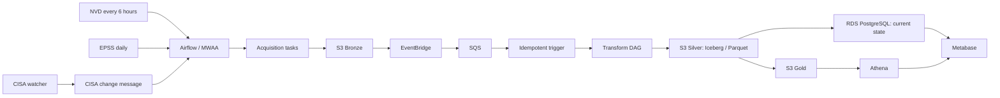

# ThreatFlow Target AWS Pipeline Implementation Plan

## 1. Goal and scope

The goal is to evolve the existing MVP into a scalable, recoverable architecture
without rewriting working source-specific ingestion logic.

The scope includes NVD, CISA KEV, EPSS, S3 Bronze/Silver/Gold, Glue Data Catalog,
Athena, RDS PostgreSQL, EventBridge, SQS/DLQ, Airflow, and Metabase. Kafka/Kinesis,
Kubernetes, Redshift, multi-region active-active, and live scanner/SIEM feeds are
explicitly deferred.

## 2. Decisions required first

Record short ADRs for AWS Region, one Infrastructure-as-Code tool, Airflow versus
MWAA timing, one primary transformation engine (Glue or ECS Fargate), Iceberg as
the Silver/Gold table format, RDS PostgreSQL as the serving store, the CISA
detection SLA, environments, tagging, and a monthly budget ceiling.

The target data ownership is:

| Dataset | System of record | Serving copy |
| --- | --- | --- |
| Raw source bytes | S3 Bronze | None |
| EPSS/NVD/CISA history | S3 Silver Iceberg | Latest state in RDS |
| Priority/trend/quality history | S3 Gold | Small current summaries in RDS if needed |
| Artifact manifests/checkpoints | RDS PostgreSQL | None |
| Airflow metadata | Separate Airflow database | None |
| Metabase metadata | Separate Metabase database | None |

Existing tables retained in RDS are `nvd_cves`, `cisa_kev_vulnerabilities`,
`epss_current`, `raw_artifacts`, and `ingestion_checkpoints`. `epss_scores` and
`cisa_kev_changes` move to Silver as authoritative history. The
`epss_daily_summaries` history moves to Gold, optionally with a small RDS serving
copy.

## 3. Data contracts

Every Raw artifact records source, bucket/key/version, SHA-256, size, acquisition
time, source effective date/window, request parameters, source revision, record
count, run ID, and schema version. Messages and XCom contain only pointers and
metadata, never the dataset.

Idempotency keys:

| Operation | Key |
| --- | --- |
| Raw artifact | `(source, sha256)` and `(bucket, key, version_id)` |
| NVD version | `(cve_id, last_modified)` |
| EPSS score | `(cve_id, score_date)` |
| CISA snapshot | catalog version or content SHA-256 |
| CISA change | `(source_revision, cve_id, change_type)` |
| Transform request | `(bucket, key, version_id, transform_version)` |

Partition NVD by day of `last_modified`, EPSS by `score_date`, CISA history by
month, and daily Gold priority by `snapshot_date`. Do not partition by CVE,
vendor, severity, or ransomware flag. Measure file sizes and compact based on
evidence.

## 4. Implementation phases

### Phase 0 — Baseline and safety net

- Measure table and Raw sizes, daily record counts, ingestion duration, and query
  patterns.
- Capture integrity invariants and recovery procedures.
- Add end-to-end fixtures for one NVD window, one CISA snapshot, and one EPSS day.
- Verify current PostgreSQL and Raw backup/restore.
- Define reconciliation reports for counts, keys, dates, hashes, and samples.

**Exit:** repeat runs are idempotent and the current MVP can be restored.

### Phase 1 — Decouple storage from ingestion

- Introduce `RawArtifactStore` with local and S3 implementations.
- Preserve existing HTTP, parsing, validation, and repository logic where
  possible.
- Separate `acquire_raw`, `validate_transform`, and `publish_current`.
- Keep manifests independent of physical paths.
- Contract-test checksums, duplicates, failed uploads, retries, and the rule that
  database publication cannot precede Raw persistence.

**Exit:** each source can target local storage or S3 through configuration.

### Phase 2 — AWS foundation and S3 Bronze

- Use IaC for dev Bronze, Silver, Gold, quarantine, and Athena-result locations.
- Enable Block Public Access, owner-enforced access, encryption, and Bronze
  versioning.
- Create least-privilege acquisition, transform, Airflow, and Athena roles;
  constrain service policies with source ARN/account conditions.
- Define lifecycle/retention, CloudTrail data events or equivalent access logs,
  CloudWatch metrics, and cost tags.
- Store S3 URIs and checksums in `raw_artifacts`.

**Exit:** all three sources write immutable Raw to S3 while current processing
still works.

### Phase 3 — Silver and replay

Implement EPSS first, CISA second, and NVD third.

- EPSS: validate date/schema/ranges/completeness, write by `score_date`, enforce
  `(cve_id, score_date)`, then update `epss_current`.
- CISA: retain valid snapshots, derive diffs, apply count/shrinkage gates, then
  update the current catalog.
- NVD: retain `(cve_id, last_modified)` versions, verify pages/windows, and
  prevent stale RDS updates.
- Add Glue Catalog registration, schema-evolution policy, atomic publication,
  compaction, quarantine, and replay by S3 URI/date range.

**Exit:** duplicate replay does not change counts; Athena can query history; RDS
current state matches the MVP.

### Phase 4 — RDS PostgreSQL and controlled dual write

- Deploy private RDS PostgreSQL reachable only by Airflow, transformation jobs,
  and Metabase.
- Separate ThreatFlow, Airflow, and Metabase databases/users.
- Configure backups, TLS, monitoring, secrets, and production deletion
  protection.
- Apply Alembic migrations and migrate current/control tables.
- Use time-bounded dual write/publish plus reconciliation, then remove it.
- Test restore and rollback before cutover.

**Exit:** RDS current state and dashboards match existing PostgreSQL.

### Phase 5 — S3 to EventBridge to SQS

- Filter only required Bronze prefixes/suffixes.
- Route normalized `RawArtifactCreated` events to a Standard SQS queue.
- Add a DLQ and narrowly scoped queue policies.
- Make the consumer register idempotency before starting an Airflow transform DAG.
- Acknowledge only after a DAG run is durably created.
- Ensure Silver/Gold outputs cannot retrigger the Bronze rule.
- Test duplicates, reordering, poison messages, consumer crashes, Airflow outage,
  DLQ redrive, and replay.

**Exit:** valid events are not lost and duplicate delivery does not duplicate data.

### Phase 6 — CISA change watcher

The watcher is an additional detection path. The existing `cisa_daily` DAG stays
as scheduled recovery/reconciliation, and Git history backfill is unchanged.

- Run a short watcher from EventBridge Scheduler at the agreed interval.
- Use conditional HTTP where supported and compare catalog version, headers, and
  SHA-256.
- Persist the response to Bronze and validate structure, count, and shrinkage.
- Publish/start a CISA run only for new valid content.
- Quarantine and alert on invalid/empty content without changing current KEV.

**Exit:** unchanged catalogs do no heavy work; new valid catalogs meet the SLA;
the daily CISA run continues to work independently of the watcher.

### Phase 7 — Gold and Metabase

Build `vulnerability_priority_daily`, `epss_trend_daily`, `kev_change_events`,
`source_freshness_daily`, and `data_quality_daily`. Publish atomically from a
specific Silver snapshot/date. Provide current RDS serving views for common
dashboards. Connect Metabase read-only to RDS and separately to Athena; do not
depend on runtime RDS-to-Athena joins for core dashboards.

**Exit:** operational dashboards use RDS and reproducible history uses Athena.

### Phase 8 — Airflow/MWAA cutover

- Keep DAGs orchestration-only.
- Schedule NVD every six hours, EPSS after expected publication, CISA by event,
  and backfill manually.
- Add source pools, concurrency limits, retries, timeouts, and non-overlap guards.
- Store secrets outside code/DAGs and test DAG imports plus one safe source smoke
  run.
- Shadow-run, then cut over one source at a time.

**Exit:** schedules, recovery, and backfill work without datasets in XCom.

### Phase 9 — Historical migration and retirement

- Migrate `epss_scores` and `cisa_kev_changes` in bounded chunks.
- Reconcile counts, keys, date ranges, aggregates, and samples.
- Move historical Metabase queries to Athena.
- Stop PostgreSQL history writes only after an observation window.
- Keep old tables read-only with a backup and defined rollback period before any
  deletion decision.

**Exit:** S3 is the historical system of record; RDS owns current/control/serving.

## 5. Cross-cutting requirements

Reliability requires at-least-once delivery with idempotent consumers, checkpoints
only after Silver/RDS commits, NVD gap detection, CISA completeness gates, EPSS
date/completeness gates, quarantine, DLQ redrive, and Bronze replay.

Security requires private RDS, TLS, Secrets Manager, short-lived IAM credentials,
least privilege, S3 Block Public Access, encryption, versioning, source-scoped
resource policies, encrypted audit logs, and no secrets or full Raw payloads in
logs.

Alerts cover failed tasks, stale sources, NVD gaps, missing EPSS dates, invalid
CISA snapshots, SQS age/depth, non-empty DLQ, transform/Iceberg failures, RDS
pressure, and Athena failures or cost anomalies.

Cost controls: start with dev and budgets; delay MWAA until the S3/Silver path is
validated because MWAA/RDS/networking create fixed spend; use Parquet and sensible
partitions to reduce Athena scan; monitor S3 request/KMS/lifecycle costs and avoid
small-file explosion; select one transformation engine from measured workload.

## 6. Release sequence and rollback

| Release | Outcome | Rollback target |
| --- | --- | --- |
| R1 | Storage abstraction and S3 Bronze | Local Raw store |
| R2 | EPSS Silver and Athena | PostgreSQL `epss_scores` |
| R3 | CISA/NVD Silver and RDS current | Existing PostgreSQL path |
| R4 | EventBridge/SQS/DLQ | Airflow downstream task |
| R5 | CISA watcher and event DAG | Scheduled CISA DAG |
| R6 | Gold and Metabase RDS/Athena | Existing Metabase queries |
| R7 | MWAA cutover and history retirement | Existing Airflow/read-only history |

Every release must deploy independently and complete reconciliation before the
old path is removed.

## 7. Target Definition of Done

The target is complete when NVD gaps are detected and recoverable; EPSS dates and
CISA catalog revisions replay safely; every result has Raw checksum and lineage;
duplicate/out-of-order events cannot regress state; Athena serves history and RDS
serves current dashboards; DLQ, quarantine, backup restore, and Bronze replay have
been exercised; tool databases/users are separated; IaC reproduces dev; and
runbooks cover source outage, missed intervals, redrive, invalid data, RDS restore,
and cutover rollback.

## 8. Open decisions before estimating dates

Confirm AWS Region/environments, CDK versus Terraform, when to adopt MWAA, Glue
versus ECS Fargate, the CISA SLA, RPO/RTO and Multi-AZ requirement, Bronze
retention, rollback duration, expected history volume, and Metabase historical
query frequency. Phases 0–2 can start before these decisions are all closed.

