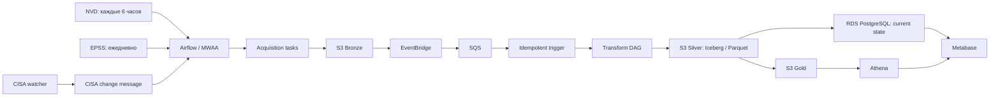

# План реализации целевого AWS pipeline ThreatFlow

## 1. Цель и границы

Цель — поэтапно перевести существующий MVP на масштабируемую и восстанавливаемую
архитектуру, не переписывая работающую source-specific ingestion логику.

Целевой поток:



В scope входят NVD, CISA KEV, EPSS, S3 Bronze/Silver/Gold, Glue Data Catalog,
Athena, RDS PostgreSQL, EventBridge, SQS/DLQ, Airflow и Metabase.

На первом этапе не входят Kafka/Kinesis, Kubernetes, Spark-кластер, Redshift,
multi-region active-active и real-time scanner/SIEM feeds. AWS Glue допускается
как managed compute для Iceberg, но не вводится одновременно с несколькими
альтернативными transformation engines.

## 2. Архитектурные решения до начала реализации

Зафиксировать короткие ADR (Architecture Decision Record):

| Решение | Рекомендуемый выбор | Что подтвердить |
| --- | --- | --- |
| AWS Region | Один регион, близкий к команде и требованиям данных | Region, budget, service availability |
| Infrastructure as Code | Один инструмент для всех ресурсов | CDK или Terraform; не смешивать без причины |
| Orchestrator | Сначала существующий Airflow; MWAA после проверки lake path | Допустимая постоянная стоимость MWAA и NAT |
| Transformation engine | AWS Glue для Iceberg или существующий Python container на ECS Fargate | Объём EPSS, время, удобство локального тестирования |
| Table format | Iceberg для Silver/Gold history; Parquet как физический формат | Поддерживаемые операции merge/upsert |
| Serving database | RDS for PostgreSQL | Размер current state, backup/RTO/RPO |
| Metabase access | RDS для dashboards, Athena для history/ad hoc | Нужны ли cross-source historical dashboards |
| CISA latency | Например, обнаружение за 30–60 минут | Реальный SLA; источник всё равно проверяется polling |

Результат этапа — утверждённые ADR, naming/tagging convention, environment
strategy (`dev`, затем `prod`) и приблизительный monthly budget ceiling.

## 3. Целевое распределение данных

| Dataset | System of record | Serving copy |
| --- | --- | --- |
| Raw NVD/CISA/EPSS bytes | S3 Bronze | Нет |
| Полная EPSS history | S3 Silver Iceberg | Только последний score в RDS |
| NVD version/history | S3 Silver Iceberg | Последняя версия в `nvd_cves` |
| CISA snapshots/change history | S3 Silver Iceberg | Текущий KEV catalog в RDS |
| Daily priority/trends/quality | S3 Gold | Небольшие current summaries в RDS при необходимости |
| Artifact manifest/checkpoints | RDS PostgreSQL | Нет |
| Airflow runtime metadata | Отдельная Airflow database | Нет |
| Metabase users/dashboards/settings | Отдельная Metabase database | Нет |

Текущие таблицы распределяются так:

- остаются в RDS: `nvd_cves`, `cisa_kev_vulnerabilities`, `epss_current`,
  `raw_artifacts`, `ingestion_checkpoints`;
- переходят в S3 Silver как авторитетная история: `epss_scores`,
  `cisa_kev_changes`, новая NVD history;
- `epss_daily_summaries` становится Gold dataset; небольшую serving-копию можно
  сохранить в RDS.

## 4. Контракты данных

До AWS-миграции определить versioned contracts.

### 4.1 Raw artifact envelope

Каждый artifact имеет:

```text
source, bucket, object_key, version_id, sha256, size_bytes,
acquired_at, source_effective_date/window, request parameters,
source_revision, record_count, ingestion_run_id, schema_version
```

Raw bytes не модифицируются. Большой payload никогда не передаётся через XCom,
EventBridge или SQS — только ссылка и metadata.

### 4.2 Idempotency keys

| Source/operation | Ключ |
| --- | --- |
| Raw artifact | `(source, sha256)` и S3 `(bucket, key, version_id)` |
| NVD Silver version | `(cve_id, last_modified)` |
| EPSS Silver | `(cve_id, score_date)` |
| CISA snapshot | `catalogVersion` или content SHA-256 |
| CISA change | `(source_revision, cve_id, change_type)` |
| Transform request | `(bucket, key, version_id, transform_version)` |

### 4.3 Partitioning

- NVD Silver: `days(last_modified)`; сортировка `last_modified, cve_id`.
- EPSS Silver: `days(score_date)`; один или несколько compact files на день.
- CISA snapshots/changes: `months(snapshot_date/change_date)`.
- Gold priority: `days(snapshot_date)`.
- Bronze: source + acquisition date/hour + run/object identity.

Не partition по CVE, vendor, severity или ransomware flag. Ввести file-size
metrics и compaction после появления реальных измерений, а не фиксировать
непроверенный размер файла заранее.

## 5. Этапы реализации

### Этап 0. Baseline и safety net

**Задачи**

1. Зафиксировать объём каждой таблицы, число daily records, размеры Raw и время
   текущих ingestion jobs.
2. Зафиксировать текущие data-quality invariants и recovery procedures.
3. Добавить end-to-end test fixtures для одного NVD window, одного CISA snapshot
   и одного EPSS day.
4. Проверить backup/restore текущего PostgreSQL и Raw storage.
5. Создать миграционный reconciliation report: counts, keys, min/max dates,
   hashes и selected record comparisons.

**Критерий готовности:** baseline воспроизводим; повторный run не создаёт
дубликаты; известен способ восстановления MVP.

### Этап 1. Отделить storage interfaces от ingestion

**Задачи**

1. Ввести интерфейс `RawArtifactStore` с local и S3 implementations.
2. Не менять HTTP clients, parsing и validation без необходимости.
3. Отделить операции `acquire_raw`, `validate_transform`, `publish_current`.
4. Сохранять manifest независимо от физического storage path.
5. Сделать event payload builder/test без подключения AWS.

**Тесты:** contract tests для local/S3 adapter; checksum; duplicate artifact;
failed upload; retry; отсутствие database writes до сохранения Raw.

**Критерий готовности:** один ingestion service может писать Raw в local или S3
по configuration без изменения source logic.

### Этап 2. AWS foundation и S3 Bronze

**Задачи**

1. IaC создаёт dev buckets/prefixes для Bronze, Silver, Gold, quarantine и Athena
   results; отдельные buckets нужны только если различаются policies/lifecycle.
2. Включить Block Public Access, bucket-owner enforced access, encryption,
   versioning для Bronze и запретить публичный доступ.
3. Создать least-privilege IAM roles для acquisition, transform, Airflow и
   Athena; service policies ограничить `aws:SourceArn`/`aws:SourceAccount`.
4. Добавить lifecycle policy: Bronze остаётся доступным для replay, старые
   versions и Athena results получают отдельные retention rules.
5. Включить CloudTrail data events/доступное логирование, CloudWatch metrics и
   cost-allocation tags.
6. Перевести `raw_artifacts.storage_path` на `s3://...` URI, сохранив SHA-256.

**Тесты:** upload/read, encryption, versioning, denied public access, denied
cross-prefix access, checksum, duplicate content, interrupted upload.

**Критерий готовности:** все три источника пишут immutable Raw в S3; локальный
fallback сохранён; normalized/current processing пока работает как раньше.

### Этап 3. Silver tables и replay

Реализовать источники по одному: сначала EPSS, затем CISA, затем NVD.

**EPSS**

1. Читать конкретный Bronze object по manifest.
2. Проверять source date, schema, ranges и completeness.
3. Писать Iceberg/Parquet по `score_date`.
4. Проверять uniqueness `(cve_id, score_date)`.
5. Обновлять `epss_current` только после успешного Silver commit.

**CISA**

1. Сохранять валидные snapshots и вычислять diff с предыдущим валидным snapshot.
2. Писать snapshot/change history в Silver.
3. Обновлять `cisa_kev_vulnerabilities` только после count/shrinkage checks.

**NVD**

1. Сохранять версии по `(cve_id, last_modified)`.
2. Не позволять старой версии заменить новую в RDS.
3. Проверять непрерывность windows и completeness всех pages.

**Общие задачи:** Glue Catalog, schema evolution policy, atomic commit,
compaction job, quarantine, replay command по S3 URI или date range.

**Критерий готовности:** повторная обработка одного Raw object не меняет counts;
исторические результаты доступны через Athena; current state совпадает с MVP.

### Этап 4. RDS PostgreSQL и controlled dual write

**Задачи**

1. Создать RDS PostgreSQL в private subnets, security group только для Airflow,
   transform jobs и Metabase.
2. Создать отдельные databases/users для ThreatFlow, Airflow и Metabase; не
   смешивать application и tool metadata.
3. Настроить automated backups, deletion protection для production, monitoring,
   TLS и secret rotation policy.
4. Применить Alembic migrations и перенести current/control tables.
5. Временно выполнять dual write или dual publish с reconciliation, но не
   поддерживать его бесконечно.
6. Запретить regression current state по `last_modified`/`score_date`.

**Reconciliation:** row counts, business keys, timestamps, selected hashes,
current NVD/EPSS/KEV equality и dashboard results.

**Критерий готовности:** RDS current state совпадает с исходным PostgreSQL;
backup restore проверен; приложение можно переключить обратно во время периода
наблюдения.

### Этап 5. Event-driven processing S3 → EventBridge → SQS

**Задачи**

1. Создать EventBridge rule только для нужного Bronze prefix/suffix.
2. Направить события в Standard SQS queue; payload нормализовать до внутреннего
   `RawArtifactCreated` contract.
3. Создать DLQ и queue policies с конкретными source ARN/account conditions.
4. Настроить visibility/retry/redrive после измерения максимального времени
   trigger operation; transform не должен выполняться внутри короткой Lambda.
5. Consumer регистрирует idempotency key и запускает transform DAG через Airflow
   API; успешное подтверждение сообщения означает, что запуск устойчиво создан.
6. Исключить рекурсию: outputs Silver/Gold не должны соответствовать Bronze rule.

**Тесты:** duplicate event, out-of-order delivery, poison message, consumer
timeout, Airflow unavailable, DLQ redrive и повторная доставка после crash.

**Критерий готовности:** ни одно валидное событие не теряется; duplicate не
создаёт duplicate data; проблемное сообщение наблюдаемо в DLQ.

### Этап 6. CISA change watcher

Watcher вводится как дополнительный путь обнаружения. Существующий `cisa_daily`
не удаляется и остаётся scheduled recovery/reconciliation path; Git history
backfill также не меняется.

**Задачи**

1. EventBridge Scheduler вызывает короткий watcher по согласованному interval.
2. Watcher использует conditional HTTP request, где поддерживается, и сравнивает
   `catalogVersion`, ETag/Last-Modified и SHA-256.
3. Новый response сначала сохраняется в Bronze и проходит structural/count/
   shrinkage validation.
4. Только валидное новое содержимое публикует `CisaCatalogUpdated` или создаёт
   CISA DAG run; неизменный hash заканчивает run без transformation.
5. Ошибка/пустой snapshot создаёт alert и quarantine artifact, но не меняет
   current KEV.

**Критерий готовности:** unchanged catalog не запускает тяжёлую обработку;
новый catalog обрабатывается в пределах CISA SLA; invalid catalog не публикуется.
Daily CISA run продолжает успешно работать независимо от watcher.

### Этап 7. Gold analytics и Metabase

**Gold datasets**

- `vulnerability_priority_daily`;
- `epss_trend_daily`;
- `kev_change_events`;
- `source_freshness_daily`;
- `data_quality_daily`.

**Задачи**

1. Сделать расчёты versioned и воспроизводимыми по Silver snapshot/date.
2. Публиковать Gold atomically после quality gates.
3. Создать RDS serving view/table для текущей карточки и priority queue.
4. Подключить Metabase read-only к ThreatFlow RDS и отдельно к Athena.
5. Metabase application metadata хранить в собственной PostgreSQL database.
6. Не делать runtime joins RDS↔Athena для основных dashboards; подготовить
   нужные cross-source joins в Gold/serving.

**Критерий готовности:** основные dashboards работают из RDS; исторические
запросы работают через Athena; результат приоритизации объясним и воспроизводим.

### Этап 8. Airflow/MWAA cutover

**Задачи**

1. Сохранить DAG как orchestration-only: schedules, dependencies, retries,
   timeouts, pools и запуск external compute.
2. Настроить NVD `0 */6 * * *`, EPSS после ожидаемой публикации, CISA event DAG и
   manual backfill DAG.
3. Настроить source-specific pools и запрет overlapping runs, где это опасно.
4. Перенести connections/secrets без секретов в code или DAG files.
5. Проверить import errors и безопасный smoke run каждого DAG.
6. Сначала shadow run, затем один source cutover за раз.

**Критерий готовности:** schedules, retry и backfill проверены; missed NVD window
обнаруживается и восстанавливается; payload datasets не идут через XCom.

### Этап 9. Historical migration и прекращение старых writes

1. Перенести существующие `epss_scores` в Silver по bounded date chunks.
2. Перенести `cisa_kev_changes`; построить/проверить NVD history, если доступна.
3. Сравнить counts, keys, ranges, aggregates и sample records.
4. Переключить Athena/Metabase historical queries на S3.
5. Прекратить запись в PostgreSQL historical tables после периода наблюдения.
6. Не удалять старые таблицы сразу: сделать read-only, сохранить backup и
   зафиксировать rollback window.

**Критерий готовности:** S3 становится system of record для history; RDS хранит
current/control/serving; старый путь можно восстановить из backup.

## 6. Сквозные требования

### Надёжность и data integrity

- at-least-once delivery + idempotent consumers;
- checkpoint только после Silver и RDS commit;
- NVD gap detection и stale-update protection;
- CISA empty/count/shrinkage validation;
- EPSS date/completeness validation;
- quarantine не считается successful ingestion;
- DLQ redrive runbook и replay из Bronze;
- различать `fetched`, `validated`, `written`, `updated`, `unchanged`, `rejected`.

### Security

- private RDS, TLS, Secrets Manager, short-lived IAM credentials;
- least privilege для каждого task role;
- S3 Block Public Access, encryption at rest/in transit, versioning;
- KMS/key policies и cross-service policies с source conditions;
- encrypted logs, CloudTrail audit и отсутствие raw payload/secrets в logs.

### Observability

Минимальные alerts: failed DAG/task, stale source, NVD coverage gap, missing EPSS
date, CISA invalid snapshot, SQS age/depth, DLQ non-empty, transform failure,
Iceberg commit/compaction failure, RDS capacity/connection pressure и Athena query
failure/cost anomaly.

### Cost controls

- Начать с dev environment и budget alerts.
- MWAA, RDS и NAT/networking создают постоянную стоимость; включать MWAA после
  проверки S3/Silver path и рассмотреть существующий Airflow на промежуточном
  этапе.
- Athena оплачивает scanned data: Parquet, projection и разумные partitions
  уменьшают scan; dashboards не должны каждый refresh читать всю историю.
- S3 стоимость включает storage, requests, KMS requests, lifecycle transitions и
  retrieval; small-file explosion увеличивает стоимость и latency.
- Glue/Fargate выбирать по измеренному времени и объёму, а не поддерживать оба
  engine для одной операции.

## 7. Рекомендуемая последовательность релизов

| Release | Результат | Можно откатить к |
| --- | --- | --- |
| R1 | Storage abstraction + S3 Bronze | Local Raw store |
| R2 | EPSS Silver + Athena | PostgreSQL `epss_scores` |
| R3 | CISA/NVD Silver + RDS current | Existing PostgreSQL path |
| R4 | EventBridge/SQS/DLQ trigger | Airflow downstream task |
| R5 | CISA watcher + event DAG | Scheduled CISA DAG |
| R6 | Gold + Metabase RDS/Athena | Existing Metabase queries |
| R7 | MWAA cutover + historical retirement | Existing Airflow + read-only history |

Каждый release должен быть independently deployable и не требовать удаления
старого пути до завершения reconciliation.

## 8. Definition of Done целевой архитектуры

1. NVD каждые шесть часов не имеет необнаруженных gaps; recovery использует
   modified backfill.
2. EPSS сохраняет каждый source date один раз и допускает безопасный replay.
3. CISA запускает обработку только для нового валидного catalog.
4. Raw bytes, checksum и lineage доступны для любого published result.
5. Повторные и переставленные события не создают дубликаты и не регрессируют
   current state.
6. История доступна через Athena; current dashboard — через RDS.
7. DLQ, quarantine, backup restore и Bronze replay проверены практическими tests.
8. Metabase, Airflow и ThreatFlow используют раздельные databases/users.
9. IaC воспроизводит dev environment без ручного DDL/configuration.
10. Runbooks описывают source outage, missed interval, DLQ redrive, invalid data,
    RDS restore и rollback каждого cutover.

## 9. Открытые решения перед оценкой сроков

Нужно подтвердить:

1. AWS Region и environments.
2. CDK или Terraform.
3. Существующий Airflow на AWS compute или MWAA с первого релиза.
4. AWS Glue или ECS Fargate как основной transformation engine.
5. CISA latency SLA.
6. RPO/RTO и обязательность Multi-AZ для учебного проекта.
7. Период хранения Bronze и rollback window старого PostgreSQL history.
8. Ожидаемый объём истории и частота Metabase historical queries.

Без этих ответов можно начинать этапы 0–2; они не блокируют storage abstraction,
data contracts и S3 Bronze.

