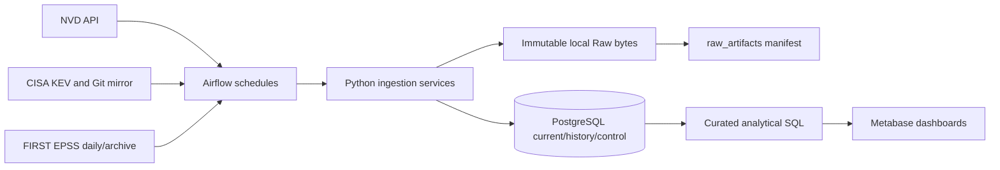

# ThreatFlow capstone report

## Executive summary

ThreatFlow is an end-to-end cybersecurity data pipeline that acquires NVD, CISA KEV and
FIRST EPSS public data, preserves exact source bytes, validates source-specific integrity,
maintains idempotent current/history tables and publishes explainable vulnerability
investigation outputs.

The intended user is a vulnerability-management, SOC or threat-intelligence analyst. The
primary product is a priority queue answering:

> Which CVEs should be investigated first, if the affected products are present in the
> organisation?

ThreatFlow combines three different signals:

- NVD CVSS and CWE describe technical severity and weakness context;
- CISA KEV identifies confirmed exploitation and remediation context;
- EPSS estimates exploitation probability and provides a daily trend.

It does not contain asset inventory, installed versions, exposure, business criticality or
remediation status. It therefore supports investigation and triage but does not claim that a
specific organisation is vulnerable.

## Capstone evidence map

| Requirement | ThreatFlow evidence |
| --- | --- |
| Problem and end user | This report and `docs/vulnerability-prioritization.en.md` |
| Candidate data assessment | `docs/dataset-assessment.md` |
| Data catalog | `docs/data-catalog.md` |
| Architecture and trade-offs | `docs/data-pipeline-treatflow.md` |
| Data model and grain | `docs/data-model.md`, SQLAlchemy models and Alembic migrations |
| Reproducible ingestion | Source-specific services under `src/threatflow/ingestion/` and Airflow DAGs |
| Raw/replay storage | `raw_storage.py` contract, local/S3 adapters, artifact manifest |
| Incremental processing | NVD modified checkpoints, CISA hashes/diffs and EPSS source dates |
| Data quality | Parser/completeness tests and `analytics/data_quality_*.sql` |
| Error/recovery demonstration | `docs/failure-recovery-demo.md`, unit/integration tests and backfill CLI |
| Logging/observability | Stage logs, Airflow state, source freshness and integrity queries |
| Governance/security | `docs/governance.md`, `.env.example`, separated database roles |
| Data product | `analytics/vulnerability_priority_queue.sql`, search/watchlist/quality queries |
| Reproduction | `README.md`, `scripts/run-capstone-demo.sh` and Airflow/CLI scripts |

## Data selection

NVD is the hero dataset, CISA KEV is the fallback dataset and EPSS is the time-series
enrichment. The complete comparison, source constraints and limitations are documented in
[dataset-assessment.md](dataset-assessment.md).

Using the three together is not unnecessary complexity: they answer different parts of the
same user decision. A high CVSS score does not mean likely exploitation, EPSS does not
measure impact, and KEV does not describe organisational exposure.

## Implemented architecture



Airflow is orchestration only. HTTP, pagination, validation and transformation belong to
ingestion modules; PostgreSQL transaction and UPSERT logic belongs to repositories. Raw
bytes are stored before parsing/database writes.

The optional AWS lakehouse design is documented separately. It is an evolution path, not a
claim about the implemented MVP.

## Incremental and recovery strategy

- **NVD:** deterministic UTC modification windows and a durable `covered_until` checkpoint.
  Failed/incomplete pagination cannot advance coverage. Historical `published` and recovery
  `modified` backfills remain distinct.
- **CISA:** each fetch is a complete snapshot. Exact-content SHA-256 identifies revisions;
  unchanged content is idempotent. The daily DAG remains reconciliation/recovery for the
  optional hourly watcher. Git history supplies historical snapshots.
- **EPSS:** source score date is the business date. `(cve_id, score_date)` preserves daily
  history, retries UPSERT safely, and an older backfill cannot regress current state.

## Data quality and failure safety

ThreatFlow validates identifiers, types, required fields, dates, score ranges, duplicates,
declared counts, plausible completeness, pagination consistency and stale versions. Invalid
or incomplete input fails the task instead of publishing success. Transactions roll back
normalised writes; previously committed chunks/dates remain replayable and Raw evidence is
retained.

The reproducible scenarios and commands are in
[failure-recovery-demo.md](failure-recovery-demo.md).

## Data product

The priority queue applies explicit, reviewable policy tiers:

- `P1`: confirmed KEV plus high EPSS or known ransomware context;
- `P2`: other confirmed KEV entries;
- `P3`: high/critical CVSS plus high EPSS outside KEV;
- `WATCH`: high/critical CVSS with a material seven-day EPSS increase.

Supporting products provide rising EPSS, ransomware subsets, CVE search, source freshness,
missing-date checks, cross-source coverage and Raw-manifest integrity. The thresholds are a
documented project policy rather than an official universal risk standard.

## Governance

The current sources contain public vulnerability intelligence rather than personal or
organisation-specific asset data. Credentials are external configuration, source ownership
and attribution are recorded, and operational/database principals are separated. Full
licensing, retention, privacy and responsible-interpretation decisions are in
[governance.md](governance.md).

## Reproduce and demonstrate

```bash
cp .env.example .env
uv sync --group dev
./scripts/run-capstone-demo.sh
```

For the complete local platform, set non-placeholder secrets in `.env`, then use the Docker
Compose instructions in the root README. Once the stack contains ingested data, run:

```bash
./scripts/run-capstone-demo.sh --with-running-stack
```

The demo never calls production APIs or performs a backfill. PostgreSQL integration tests
use disposable containers; read-only analytical mode uses the already-running local stack.

## Limitations and future improvements

- Add asset inventory and product matching before making organisation-specific claims.
- S3 Bronze replication, historical reconciliation and an exact-byte restore drill are now
  verified in the development account; retain the dated evidence and resolve the documented
  pre-fix invalid-object cleanup before treating the layer as fully complete.
- Move large historical analytical storage to Parquet/Iceberg only after the local capstone
  is fully demonstrated and cost/volume measurements justify it.
- Add CI execution of lint/unit tests and an environment with Docker for integration and
  Airflow DAG parsing.
- Perform and record a measured backup/restore drill and final RPO/RTO.
- Improve run-level fetched/validated/written/unchanged/rejected metrics.

The project intentionally avoids Kafka, Spark, Kubernetes or other distributed components
that do not add value at its current scale.

