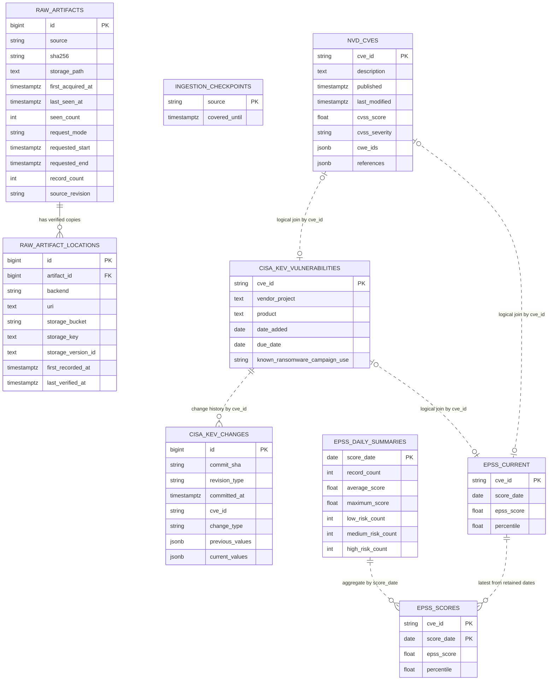

# ThreatFlow data model

## Model objective

The implemented local model separates immutable evidence, operational coverage, current
serving state, retained history and analytical outputs. It is deliberately smaller than the
target AWS lakehouse: PostgreSQL and local Raw storage are sufficient for the capstone MVP.

Dotted relationships are logical analytical joins, not database foreign keys. A source may
legitimately publish a CVE before or without another source.

## Table roles and grains

| Layer | Table/storage | Grain | Role |
| --- | --- | --- | --- |
| Raw | Local path or `s3://bucket/bronze/source=<source>/sha256=<sha256>.<ext>` | One exact unique payload per source/hash | Replayable immutable evidence |
| Manifest | `raw_artifacts` | One source/hash | Searchable Raw provenance and observation metadata |
| Location | `raw_artifact_locations` | One artifact/backend | Independently verified local and S3 copies |
| Coverage | `ingestion_checkpoints` | One source | Last completely committed NVD modified-window boundary |
| Current | `nvd_cves` | One CVE | Latest accepted NVD projection |
| Current | `cisa_kev_vulnerabilities` | One CVE | Latest accepted KEV state |
| History | `cisa_kev_changes` | One revision/CVE event | Derived CISA baseline/add/modify/remove history |
| History | `epss_scores` | One CVE/source date | Configurably retained detailed score history |
| Current | `epss_current` | One CVE | Latest accepted EPSS score |
| Aggregate | `epss_daily_summaries` | One source date | Permanent daily EPSS summary |
| Analytical | `analytics/*.sql` | Query-specific | Priority queue, search, trends, freshness and quality results |

## Write invariants

1. Raw exact bytes are persisted before parsing or normalized database writes.
2. `(source, sha256)` and all business keys are idempotent under retry.
3. One logical artifact may have both local and S3 locations; reads never silently cross backend.
4. NVD current state changes only when the incoming `last_modified` is not older.
5. EPSS history is keyed by source date; `epss_current` cannot regress to an older date.
6. CISA accepts only non-empty, structurally valid, count-consistent snapshots and rejects
   implausible shrinkage against an established current table.
7. An incomplete NVD pagination traversal does not advance the coverage checkpoint.
8. CISA omissions do not physically delete current rows.
8. Operational errors roll back normalized writes and propagate to Airflow as failed tasks.

## Analytical model

The main product is a read-only vulnerability priority queue. It builds a CVE universe from
CISA KEV and current EPSS, then left-joins NVD, CISA and recent EPSS signals. Left joins are
intentional: temporarily missing enrichment must not hide a confirmed KEV entry.

The policy produces explainable `P1`, `P2`, `P3` and `WATCH` tiers. It does not materialise
an opaque universal risk score and does not claim organisational exposure. Supporting SQL
provides ransomware context, rising EPSS, vulnerability search and data-quality status.

## Evolution boundary

At current scale PostgreSQL is the serving and analytical store. The documented target can
move immutable Raw to S3 and multi-year history to Parquet/Iceberg while preserving these
business grains and invariants. AWS services are an optional extension, not a prerequisite
for the capstone MVP.

