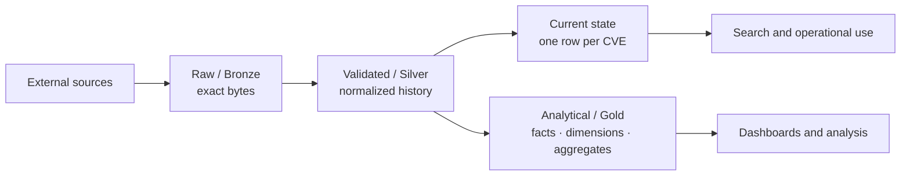
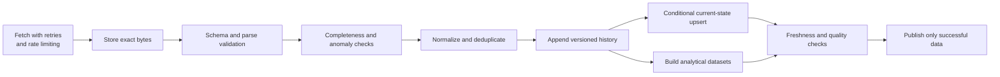
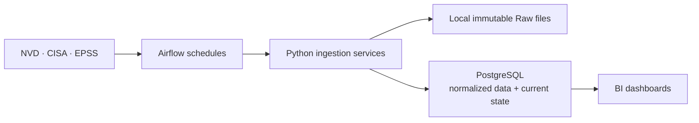
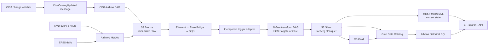
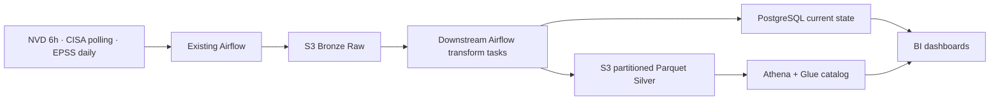
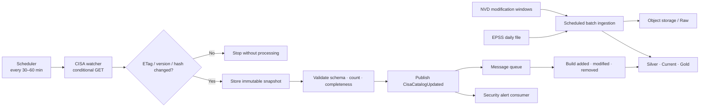
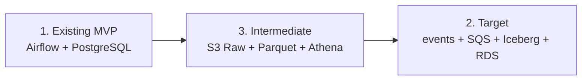

# Архитектурное исследование pipeline данных об уязвимостях

## Цель

Этот документ проектирует систему с нуля и не зависит от реализации конкретного
MVP. Задача системы — регулярно получать публичные данные об уязвимостях,
сохранять их без потери истории, проверять качество, объединять по CVE и
превращать в информацию для приоритизации и исследования.

Основные вопросы:

1. Какие данные приходят и в каком виде?
2. Как они изменяются и от чего зависит частота получения?
3. Как хранить исходные, нормализованные и аналитические данные?
4. Как обрабатывать их повторяемо и без потери изменений?
5. Какие архитектуры подходят и какая из них лучше?

## 1. Пользователи и решения

| Пользователь | Решение, которое нужно принять | Результат системы |
| --- | --- | --- |
| Vulnerability management | Какие CVE исследовать первыми? | Объяснимая очередь приоритетов |
| SOC / threat intelligence | Что уже эксплуатируется и какие сигналы усиливаются? | KEV membership, EPSS trend, ransomware context |
| Security engineering | Какие продукты, поставщики и типы слабостей повторяются? | Поиск, группировки и cross-source enrichment |
| Incident response | Что известно о конкретной CVE прямо сейчас? | Единая карточка CVE из нескольких источников |
| Security leadership | Свежи и полны ли данные? | Freshness, coverage и data-quality indicators |
| Data engineering | Можно ли повторить расчёт и восстановить пропуск? | Raw history, checkpoints, lineage и replay |

Система поддерживает triage и investigation. Без asset inventory, установленных
версий, внешней экспозиции, business criticality и remediation status она не
может утверждать, что конкретная организация уязвима.

## 2. Анализ источников

### 2.1 Сводка

| Источник | Как получаем | Формат | Тип изменения | Естественная частота |
| --- | --- | --- | --- | --- |
| NVD | REST API 2.0, фильтры дат, пагинация | JSON | Новые CVE и последующие изменения существующих CVE | Инкрементально несколько раз в день или ежедневно; частота зависит от допустимой задержки и API limits |
| CISA KEV | Полный feed или официальный Git mirror | JSON / CSV | Нерегулярно обновляемый полный каталог | Проверка ежедневно или чаще в рабочие часы США; новая версия появляется только при изменении KEV |
| FIRST EPSS | Дневной файл или API | `CSV.GZ` / JSON | Полный новый score set для всех оцениваемых CVE | Один раз в день после публикации daily scores |

### 2.2 NVD: изменяемые записи

NVD содержит CVE descriptions, publication и modification timestamps, CVSS,
CWE, references и affected configurations. API возвращает пагинированный JSON.
Для синхронизации важен не только момент публикации CVE, но и `lastModified`:
описание, severity, references или affected products могут измениться позже.

Следствия для pipeline:

- incremental ingestion должен читать окно модификаций;
- checkpoint хранит последнее полностью успешное окно;
- соседние окна должны быть детерминированы и не иметь разрывов;
- небольшое перекрытие допустимо только вместе с idempotent upsert;
- backfill по `published` и recovery по `modified` — разные операции;
- все страницы одного запроса должны быть получены и проверены;
- более старая версия CVE не должна перезаписать более новую.

Периодичность NVD определяется требуемой свежестью, API rate limits, размером
окна и временем полного обхода страниц. Если аналитике достаточно дневной
свежести, daily micro-batch проще и дешевле. Для оперативного security feed можно
использовать несколько запусков в день, но это всё ещё polling, а не streaming.

### 2.3 CISA KEV: текущий snapshot

CISA KEV — каталог уязвимостей с подтверждённой эксплуатацией. Feed содержит
metadata каталога (`catalogVersion`, `dateReleased`, `count`) и массив записей с
CVE ID, vendor, product, датой добавления, required action, due date и ransomware
context. Официальный Git mirror обновляется вскоре после canonical source,
обычно в рабочие дни и часы США, когда есть новые или изменённые записи.

Следствия:

- каждый fetch получает полный snapshot, а не delta;
- polling можно выполнять регулярно, но обработку запускать только при новом
  content hash или `catalogVersion`;
- declared `count` должен совпадать с фактическим числом записей;
- пустой или резко усечённый snapshot нельзя автоматически считать успешным;
- текущую таблицу удобно хранить отдельно от истории изменений;
- история Git commits или diff последовательных snapshots позволяет получить
  события `added`, `modified`, `removed`;
- отсутствие записи в snapshot не должно безусловно запускать физическое
  удаление: сначала требуется validation и политика soft delete/history.

Периодичность определяется не объёмом, а допустимой задержкой обнаружения нового
KEV. Daily polling достаточно для большинства аналитических use cases. Более
частая проверка полезна для operational alerting, но не создаёт новых данных,
если catalog version не изменилась.

### 2.4 EPSS: дневной временной ряд

EPSS публикует для каждой CVE probability `epss` и относительный `percentile`.
Probability оценивает вероятность наблюдаемой эксплуатации в следующие 30 дней.
Scores пересчитываются ежедневно для всего корпуса CVE; изменение score отражает
изменение входных threat signals, а не обязательно изменение модели.

Следствия:

- ключ исторической записи — `(cve_id, score_date)`;
- source score date нельзя заменять acquisition timestamp;
- файл следует получать после ожидаемого времени публикации и повторять запрос,
  если архив ещё не появился;
- полный дневной файл лучше API lookup по одной CVE для построения локального
  аналитического набора;
- требуется проверка schema, score ranges, date и правдоподобия record count;
- смена версии модели может создавать структурный сдвиг во временном ряду и
  должна сохраняться как metadata;
- `percentile` нельзя интерпретировать как probability.

EPSS имеет естественную дневную периодичность. Запуск чаще одного успешного
полного получения в день не улучшает данные.

## 3. От чего зависит расписание ingestion

Расписание не следует выбирать произвольно или делать одинаковым для всех
источников.

| Фактор | Влияние |
| --- | --- |
| Publication cadence | Нельзя получить новый EPSS раньше ежедневной публикации; KEV меняется нерегулярно |
| Требуемая свежесть | Отчёт следующего утра допускает daily batch; alerting может требовать более частого KEV/NVD polling |
| API limits | Ограничивают размер окна, page size и параллелизм NVD |
| Объём и время обработки | Следующий run не должен накладываться на незавершённый предыдущий run того же источника |
| Стоимость | Частый polling, compute и warehouse queries увеличивают расходы без обязательного роста ценности |
| Recovery objective | Чем реже checkpoint, тем больше окно повторной обработки после сбоя |
| Downstream SLA | Dashboard к 08:00 UTC задаёт deadline, относительно которого строится расписание |

Рекомендуемая базовая политика:

- EPSS — один успешный run в день после публикации;
- CISA KEV — daily polling для аналитики или polling раз в несколько часов для
  alerting, с обработкой только изменившегося content;
- NVD — daily или несколько раз в день по modification windows;
- отдельный scheduled gap detector проверяет непрерывность coverage;
- backfill запускается независимо от daily jobs и разделяет с ними source limits.

## 4. Модель хранения

Одно хранилище не обязано одинаково хорошо решать audit, history, serving и BI.
Полезно разделить данные на логические слои.



### 4.1 Raw / Bronze

Хранит точные response bytes без изменения: JSON, CSV.GZ, request parameters,
HTTP metadata, acquisition time, source date, checksum и pipeline run ID.

Лучший тип storage — object storage: локальная файловая система для прототипа,
S3-совместимое хранилище для целевой системы. Object key не должен быть
единственным каталогом; searchable manifest хранится отдельно.

Raw layer нужен для replay, audit, расследования source defects и повторной
нормализации после изменения parser. Объекты immutable; одинаковый content hash
может дедуплицироваться.

### 4.2 Validated / Silver

Хранит типизированную, очищенную историю с source-specific metadata. Для большой
истории подходит Parquet с partitioning по source date. Он эффективнее JSON/CSV
для columnar analytical scans и сжимается без потери исходного Raw layer.

Рекомендуемый partitioning определяется временем, по которому чаще всего
фильтруются аналитические запросы. Частота ingestion сама по себе не является
причиной создавать отдельную partition: шестичасовой NVD run не требует
hourly-partition.

```text
bronze/source=nvd/acquired_date=2026-11-06/hour=12/run_id=.../page=....json
bronze/source=epss/acquired_date=2026-11-06/score_date=2026-11-06/....csv.gz
bronze/source=cisa/acquired_date=2026-11-06/revision=.../....json
```

Raw/Bronze paths описывают время получения и запуск; они нужны для replay, а не
для BI. Для Silver используются source-effective dates:

| Dataset | Partition strategy | Почему |
| --- | --- | --- |
| NVD CVE history | День `last_modified`; сортировка по `last_modified, cve_id` | Основные запросы ищут изменения за день/период; hour создаст много мелких partitions |
| EPSS history | День `score_date`; внутри файла данные многих CVE | Один полный score set естественно соответствует одному source day |
| CISA snapshots | Месяц `snapshot_date` | Каталог мал и меняется нерегулярно; daily partition часто будет пустой или слишком маленькой |
| CISA change events | Месяц `change_date` | Изменений мало; более мелкая partition не окупает metadata overhead |
| Gold priority snapshot | День `snapshot_date` | Позволяет воспроизвести ежедневный список приоритетов |

При использовании Apache Iceberg это могут быть hidden transforms
`days(last_modified)`, `days(score_date)` и `months(snapshot_date)`. Не следует
partition по `cve_id`, vendor, product, severity или ransomware flag: это
high-cardinality либо слишком маленькие группы. Transformation объединяет
маленькие outputs и периодически выполняет compaction; один файл на каждую CVE
недопустим.

### 4.3 Current state / Serving

Реляционная БД подходит для текущей карточки CVE, joins, фильтров и dashboard
queries с низкой задержкой:

- `cve_current` — описание, CVSS, CWE и last modified;
- `kev_current` — текущее членство и remediation metadata;
- `epss_current` — последний score и score date;
- checkpoints, manifests и run status.

Запись выполняется через unique keys и conditional upsert. Старая NVD version и
старый EPSS date не должны регрессировать current state.

### 4.4 Analytical / Gold

Gold datasets должны отвечать на конкретные вопросы, а не копировать все Silver
поля:

- vulnerability priority queue;
- daily source freshness;
- EPSS trends и rising-risk watchlist;
- KEV additions и ransomware-related subset;
- vendor/product/CWE distributions;
- cross-source coverage и data-quality metrics.

Gold можно хранить как materialized tables в PostgreSQL для небольшого объёма или
как Parquet/Iceberg tables для многолетней аналитики.

## 5. Обработка данных



### 5.1 Правила обработки

1. Сначала сохранить bytes, затем parse и write.
2. Отделять acquisition time, source effective time и processing time.
3. Валидировать не только schema, но и полноту.
4. Дедуплицировать по business key и source version/date.
5. Не обновлять current state более старой версией.
6. Фиксировать checkpoint только после полного успешного commit.
7. Публиковать Gold atomically, чтобы BI не видел половину нового набора.
8. Quarantine сохраняет невалидные artifacts для анализа, но run остаётся failed.
9. Повторный run должен быть idempotent.
10. Метрики различают fetched, validated, inserted, updated, unchanged и rejected.

### 5.2 Получаемая информация

Обогащённая карточка CVE объединяет разные смыслы:

- CVSS: техническая тяжесть;
- EPSS: вероятность эксплуатации в следующие 30 дней;
- KEV: подтверждённая эксплуатация;
- ransomware flag: подтверждённый CISA context;
- NVD modification history: изменение знаний о CVE;
- asset context, если появится: применимость к конкретной организации.

Приоритет должен быть объяснимым набором правил или признаков, а не
непрозрачным суммарным score. Например, KEV membership может иметь более высокий
приоритет, чем высокий CVSS без признаков эксплуатации, а EPSS trend помогает
найти CVE с быстро растущим attention.

## 6. Три варианта pipeline

### 6.1 Вариант 1: существующий MVP



Это текущая capstone-архитектура: Airflow координирует source-specific Python
services, а PostgreSQL хранит application data.

**Плюсы:** минимальное число компонентов, локальная воспроизводимость, простые
транзакции и joins, низкая стоимость и быстрый путь к работающей аналитике.

**Минусы:** многолетняя EPSS history увеличивает БД; raw files хуже доступны
нескольким workers; analytics конкурирует с ingestion; replay больших периодов
дороже.

**Ограничения:** Raw files привязаны к одному host; многолетняя EPSS history и
аналитика конкурируют с ingestion за PostgreSQL; horizontal scaling, replay и
независимое масштабирование compute сложнее.

### 6.2 Вариант 2: целевой event-driven lakehouse на AWS



Управление запуском:

- Airflow запускает NVD каждые шесть часов по непрерывным modification windows и
  EPSS один раз в день после публикации source file.
- CISA watcher выполняет conditional request и сравнивает `catalogVersion`,
  `ETag` или SHA-256. Только новое валидное содержимое создаёт сообщение
  `CisaCatalogUpdated`.
- Сообщение содержит ссылку, version и hash, а не весь catalog. Trigger adapter
  создаёт CISA DAG run через Airflow REST API с детерминированным run key.
- После записи Raw object событие S3 проходит через EventBridge в SQS. Consumer
  идемпотентно запускает source-specific transform DAG. Airflow остаётся
  orchestrator, а SQS даёт buffering, retry и DLQ.
- Delivery считается at-least-once. Ключ `(bucket, key, version_id)` и
  `content_sha256` защищает от дублирования.

Хранение и обработка:

1. **S3 Bronze:** точные bytes, versioning, encryption, checksums, request
   metadata и lifecycle policy. Невалидный artifact остаётся в quarantine.
2. **Transform:** schema и completeness checks, нормализация, deduplication и
   quality gates. Lambda используется только как короткий trigger; большие
   EPSS/NVD transforms выполняются в ECS Fargate или AWS Glue.
3. **S3 Silver:** Apache Iceberg tables над Parquet. Iceberg добавляет atomic
   commits, schema evolution, snapshots и безопасные merges.
4. **RDS PostgreSQL:** current state, checkpoints/manifests и low-latency UI/API.
5. **S3 Gold:** аналитические datasets, публикуемые после quality checks. Glue
   Data Catalog описывает tables, Athena выполняет historical/ad-hoc SQL.

Рекомендуемые Gold datasets: `vulnerability_priority_daily`,
`epss_trend_daily`, `kev_change_events`, `source_freshness_daily` и
`data_quality_daily`. После появления asset inventory добавляется
`asset_vulnerability_exposure`, связывающий CVE с реально установленными
продуктами и business criticality.

Надёжность обеспечивают SQS DLQ; source checkpoints; gap detector для NVD windows
и EPSS dates; CISA count/shrinkage checks; atomic Iceberg commits; Airflow pools;
CloudWatch alerts по lag, freshness, failed runs и rejected records. Более старая
NVD version или EPSS date не может регрессировать current state.

**Плюсы:** независимое масштабирование storage и compute, полная история, дешёвый
replay, устойчивое buffering, быстрый CISA trigger и эффективная многолетняя
аналитика.

**Минусы:** больше managed services, IAM policies, metadata, compaction и
observability; стоимость и operational complexity выше MVP.

**Когда выбирать:** как целевую архитектуру, когда история, replay, надёжность и
масштабирование являются требованиями продукта.

### 6.3 Вариант 3: промежуточный S3 batch



Acquisition DAG сохраняет Raw в S3 и сам запускает downstream transformation.
CISA пока проверяется Airflow по расписанию, например каждые несколько часов, и
обработка пропускается при прежнем hash.

**Плюсы:** S3 даёт shared durable Raw и replay; Parquet/Athena разгружает
PostgreSQL; можно измерить реальные volumes, query patterns и partitioning до
внедрения event infrastructure.

**Минусы:** transformation зависит от acquisition DAG; слабее isolation и
buffering, нет DLQ между S3 и обработкой, CISA latency зависит от polling.

**Когда выбирать:** как безопасный миграционный этап от варианта 1 к варианту 2.

#### Детали CISA-триггера варианта 2

Целевой вариант сохраняет естественный batch-процесс для NVD и EPSS, но использует
лёгкий watcher для быстрого обнаружения изменений CISA KEV. Это не настоящий
stream от CISA: внешний источник по-прежнему проверяется через polling, а
event-driven обработка начинается внутри нашей системы только после обнаружения
нового snapshot.



Порядок действий для CISA:

1. Watcher отправляет conditional HTTP request с последним `ETag` или
   `Last-Modified`, если endpoint поддерживает эти headers.
2. При `304 Not Modified` run завершается без скачивания и transformation.
3. При новом response вычисляется SHA-256; уже обработанный hash пропускается.
4. Новые bytes сохраняются как immutable Raw artifact.
5. До публикации события проверяются JSON schema, declared count, обязательные
   поля и правдоподобие размера каталога.
6. Валидный snapshot получает событие `CisaCatalogUpdated`, содержащее hash,
   version и ссылку на artifact, но не весь dataset.
7. Idempotent consumer сравнивает snapshots, обновляет current state и пишет
   историю изменений.
8. Невалидный snapshot остаётся в quarantine, создаёт operational alert и не
   заменяет последнее корректное состояние.

Для одного consumer достаточно обычной durable queue. Если database updater,
alerting, search indexing и data-quality processing должны получать одно событие
независимо, используется fan-out: event bus или topic направляет копию события в
отдельную очередь каждого consumer. Kafka/Kinesis для редких обновлений CISA не
нужны.

**Плюсы:** новые KEV обнаруживаются быстрее daily batch; неизменившийся каталог
не запускает тяжёлую обработку; consumers развязаны; повторная доставка безопасна
благодаря unique `(source, content_sha256)`.

**Минусы:** watcher всё равно выполняет polling; появляются queue, event schema,
DLQ и состояния обработки; схема сложнее варианта A и не решает хранение большой
EPSS history так хорошо, как вариант B.

Этот control-flow нужен, когда новые KEV должны попадать в обработку быстрее
daily batch. Для редких обновлений CISA Kafka/Kinesis не нужны.

## 7. Сравнение и выбор

| Критерий | 1: MVP | 3: промежуточный | 2: целевой AWS |
| --- | --- | --- | --- |
| Время внедрения | Минимальное | Среднее | Максимальное |
| Raw durability и replay | На одном host | S3 | S3 + event replay/control |
| Масштабирование compute | Ограниченное | Частичное | Независимое и source-specific |
| CISA latency | До daily run | До polling run | После сообщения об изменении |
| Многолетняя EPSS аналитика | Дороже в PostgreSQL | Parquet/Athena | Iceberg/Parquet/Athena |
| Защита от burst/failure | Airflow retries | Airflow retries | SQS buffering, retries и DLQ |
| Operational complexity | Низкая | Средняя | Высокая |
| Лучшее назначение | Проверка идеи | Безопасная миграция | Масштабируемая целевая система |

### 7.1 Рекомендация

Вариант 2 — правильная целевая архитектура для требования «scalable и
reliable». Он сохраняет batch-модель NVD и EPSS, использует события там, где они
дают ценность, и разделяет immutable Raw, historical analytics, current-state
serving и orchestration.

Kafka/Kinesis не нужны: источники не создают непрерывный high-throughput stream.
EventBridge отвечает за routing, SQS — за durable buffering, Airflow — за
workflow, dependencies, backfill и recovery.

### 7.2 Порядок миграции

Вариант 1 остаётся лучшей точкой старта, а вариант 3 уменьшает риск перехода к
целевой архитектуре. Причины выбора варианта 2 как конечного состояния:

1. Все источники по природе batch или snapshot; CISA message — событие об
   обнаруженном изменении, а не искусственный streaming feed.
2. EPSS создаёт полный дневной временной ряд, который естественно хранить в
   columnar object storage.
3. NVD и CISA требуют replay и реконструкции состояния, что обеспечивает Raw
   layer.
4. PostgreSQL остаётся полезным для current state, joins и UI, но не обязан
   хранить всю тяжёлую историю.
5. Storage и compute масштабируются независимо.
6. Новые источники можно добавлять в Bronze/Silver без изменения serving API.

Рекомендуемый путь эволюции:



Сначала переносится Raw в S3 и измеряются реальные размеры и запросы. Затем
добавляются Parquet/Iceberg и Athena. После этого вводятся S3 events/SQS и CISA
change message без переписывания работающих ingestion services.

## 8. Cloud mapping

Архитектура не должна зависеть от cloud provider. Возможное AWS-соответствие:

| Логическая роль | AWS implementation |
| --- | --- |
| Object storage | Amazon S3 |
| Workflow orchestration | Amazon MWAA или другой orchestrator |
| Периодический CISA watcher | Amazon EventBridge Scheduler + AWS Lambda |
| Event routing и durable queue | Amazon EventBridge + Amazon SQS |
| Container execution | Amazon ECS on Fargate |
| Container registry | Amazon ECR |
| Serving database | Amazon RDS for PostgreSQL |
| Catalog | AWS Glue Data Catalog |
| SQL по lake | Amazon Athena |
| Logs и metrics | Amazon CloudWatch |
| Secrets | AWS Secrets Manager |

Это mapping, а не обязательный набор сервисов. Для MVP managed orchestration и
NAT могут давать непропорционально большую постоянную стоимость. Локальный Docker
Compose или один compute instance проще; S3 и RDS можно подключать постепенно.

## 9. Термины и аббревиатуры

| Термин | Расшифровка / объяснение |
| --- | --- |
| CVE | Common Vulnerabilities and Exposures — идентификатор уязвимости |
| NVD | National Vulnerability Database |
| CISA | Cybersecurity and Infrastructure Security Agency |
| KEV | Known Exploited Vulnerabilities |
| FIRST | Forum of Incident Response and Security Teams |
| EPSS | Exploit Prediction Scoring System |
| CVSS | Common Vulnerability Scoring System |
| CWE | Common Weakness Enumeration |
| SOC | Security Operations Center |
| SIEM | Security Information and Event Management |
| API | Application Programming Interface |
| DAG | Directed Acyclic Graph — workflow tasks и dependencies |
| SLA | Service-Level Agreement — требование к времени/качеству сервиса |
| Conditional GET | HTTP request, который возвращает content только при изменении resource |
| ETag | HTTP identifier версии content, используемый с `If-None-Match` |
| Event bus | Компонент маршрутизации одного события нескольким consumers |
| Queue | Устойчивая очередь сообщений между producer и consumer |
| DLQ | Dead-letter queue — отдельная очередь для сообщений, которые не удалось обработать |
| Raw / Bronze | Неизменённые bytes источника |
| Silver | Валидированная нормализованная история |
| Gold | Наборы, подготовленные под аналитические вопросы |
| Snapshot | Полное состояние dataset в момент времени |
| Checkpoint | Устойчиво сохранённая граница успешной обработки |
| Backfill | Загрузка или повторная обработка прошлых периодов |
| Upsert | Insert новой строки или update существующей по ключу |
| Idempotency | Безопасная повторяемость без дубликатов и регресса данных |
| Lineage | Связь результата с source artifact и pipeline run |
| Parquet | Columnar формат файлов для аналитики |
| Iceberg | Table format над object storage с snapshots и schema evolution |
| BI | Business Intelligence — dashboards и аналитические отчёты |

## 10. Источники и проверяемые допущения

- [NVD CVE API](https://nvd.nist.gov/developers/vulnerabilities) — параметры
  modification/publication windows, pagination и API guidance.
- [CISA KEV data repository](https://github.com/cisagov/kev-data) — официальные
  JSON/CSV, schema, Git history и update schedule.
- [FIRST EPSS FAQ](https://www.first.org/epss/faq) — смысл probability, daily
  cadence и ограничения интерпретации.
- [Official EPSS score archive](https://github.com/empiricalsec/epss_scores) —
  исторические daily files, поля и даты смены model versions.
- [Amazon MWAA REST API](https://docs.aws.amazon.com/mwaa/latest/userguide/access-mwaa-apache-airflow-rest-api.html)
  — внешний запуск Airflow DAG runs.
- [Athena partitioning guidance](https://docs.aws.amazon.com/athena/latest/ug/ctas-partitioning-and-bucketing-what-is-partitioning.html)
  и [data optimization](https://docs.aws.amazon.com/athena/latest/ug/performance-tuning-data-optimization-techniques.html)
  — выбор partitions и контроль small files.
- [Athena with AWS Glue Data Catalog](https://docs.aws.amazon.com/athena/latest/ug/data-sources-glue.html)
  и [Apache Iceberg on AWS](https://docs.aws.amazon.com/prescriptive-guidance/latest/apache-iceberg-on-aws/getting-started.html)
  — catalog и transactional lakehouse tables.
- [AWS messaging decision guide](https://docs.aws.amazon.com/decision-guides/latest/decision-guides/sns-or-sqs-or-eventbridge.html)
  — роли EventBridge/SQS и at-least-once delivery.

Параметры API, schemas, publication times и cloud capabilities могут меняться.
Перед реализацией их следует повторно проверить по официальной документации.
