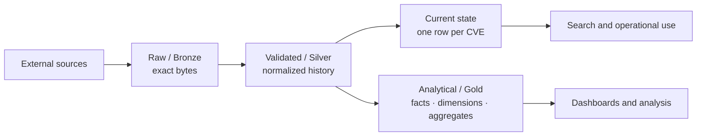
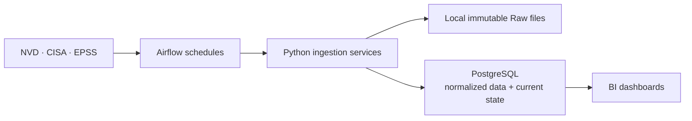
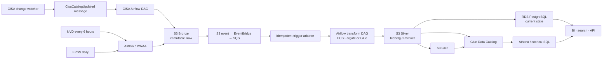
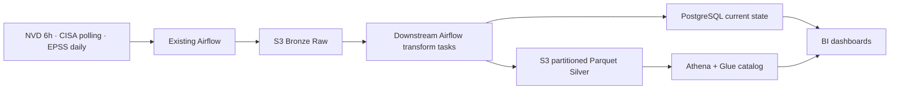
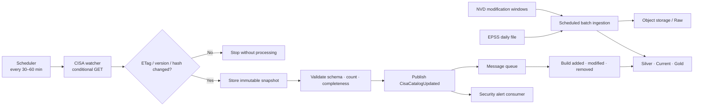
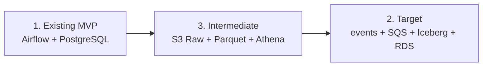

# Architectural study of a vulnerability intelligence data pipeline

## Purpose

The system regularly acquires public vulnerability
data, retains history without loss, validates quality, correlates records by CVE,
and turns them into information for prioritization and investigation.

The core questions are:

1. What data arrives and in which format?
2. How does it change, and what determines acquisition frequency?
3. How should raw, normalized, and analytical data be stored?
4. How should processing remain repeatable and lossless?
5. Which architectures fit, and which one is best?

## 1. Users and decisions

| User | Decision | System output |
| --- | --- | --- |
| Vulnerability management | Which CVEs should be investigated first? | An explainable priority queue |
| SOC / threat intelligence | What is already exploited and which signals are increasing? | KEV membership, EPSS trends, and ransomware context |
| Security engineering | Which products, vendors, and weakness types recur? | Search, aggregation, and cross-source enrichment |
| Incident response | What is currently known about a particular CVE? | A unified multi-source CVE record |
| Security leadership | Is the data fresh and complete? | Freshness, coverage, and data-quality indicators |

The system supports triage and investigation. Without asset inventory, installed
versions, external exposure, business criticality, and remediation status, it
cannot claim that a specific organisation is vulnerable.

## 2. Source analysis

### 2.1 Summary

| Source | Acquisition | Format | Change type | Natural frequency |
| --- | --- | --- | --- | --- |
| NVD | REST API 2.0, date filters, pagination | JSON | New CVEs and later modifications to existing CVEs | Incrementally several times per day or daily; frequency depends on acceptable latency and API limits |
| CISA KEV | Complete feed or official Git mirror | JSON / CSV | Irregularly updated complete catalog | Poll daily or more often during US business hours; a new version exists only when KEV changes |
| FIRST EPSS | Daily file or API | `CSV.GZ` / JSON | A complete new score set for all scored CVEs | Once per day after daily score publication |

### 2.2 NVD: mutable records

NVD contains CVE descriptions, publication and modification timestamps, CVSS,
CWE, references, and affected configurations. Its API returns paginated JSON.
Synchronization must use `lastModified`, not only the original publication time,
because descriptions, severity, references, or affected products may change.

Pipeline implications:

- incremental ingestion reads modification windows;
- a checkpoint records the last fully successful window;
- adjacent windows are deterministic and gap-free;
- a small overlap is safe only with idempotent upserts;
- `published` backfill and `modified` recovery are different operations;
- every page of a request must be retrieved and validated;
- an older CVE version must never overwrite a newer version.

NVD frequency depends on freshness requirements, API rate limits, window size,
and pagination time. A daily micro-batch is simpler when daily freshness is
enough. An operational security feed may poll several times per day, but this is
still polling rather than streaming.

### 2.3 CISA KEV: current snapshot

CISA KEV is a catalog of vulnerabilities with confirmed exploitation. The feed
contains catalog metadata (`catalogVersion`, `dateReleased`, and `count`) plus
records containing CVE ID, vendor, product, date added, required action, due
date, and ransomware context. The official Git mirror updates shortly after the
canonical source, typically on US business days and hours when entries change.

Pipeline implications:

- every fetch returns a complete snapshot rather than a delta;
- polling can be regular, while processing occurs only for a new content hash or
  `catalogVersion`;
- declared `count` must equal the actual record count;
- an empty or implausibly truncated snapshot must not succeed automatically;
- current state and change history should be separate;
- Git history or diffs between snapshots can derive `added`, `modified`, and
  `removed` events;
- absence from a snapshot must not trigger unconditional physical deletion
  before validation and a soft-delete/history policy.

Frequency depends on acceptable delay in detecting a new KEV, not dataset size.
Daily polling is enough for most analytical use cases. More frequent polling can
support alerts but does not produce new information when the catalog is unchanged.

### 2.4 EPSS: daily time series

EPSS publishes an `epss` probability and relative `percentile` for each CVE. The
probability estimates observed exploitation over the next 30 days. Scores are
recomputed daily for the complete CVE corpus; score movement reflects changing
threat signals and does not necessarily mean the model changed.

Pipeline implications:

- the historical key is `(cve_id, score_date)`;
- source score date must not be replaced with acquisition time;
- acquisition should run after expected publication and retry when the archive
  is not yet available;
- a full daily file is preferable to per-CVE API lookups for a local analytical
  dataset;
- validation covers schema, score ranges, date, and plausible record count;
- model version changes may create structural breaks and must be retained as
  metadata;
- percentile must not be interpreted as probability.

EPSS has a natural daily cadence. Running more often than one successful full
acquisition per day does not improve the data.

## 3. Storage model

One store does not need to solve audit, history, serving, and BI equally well.
Separate logical layers are useful.



### 3.1 Raw / Bronze

Retains exact response bytes without modification: JSON, CSV.GZ, request
parameters, HTTP metadata, acquisition time, source date, checksum, and pipeline
run ID.

Object storage is the best storage category: a local filesystem for a prototype
and S3-compatible storage for a target system. The object key must not be the
only catalog; a searchable manifest is stored separately.

The Raw layer enables replay, audit, investigation of source defects, and
re-normalization after parser changes. Objects are immutable, and identical
content hashes may be deduplicated.

### 3.2 Validated / Silver

Contains typed, cleaned history with source-specific metadata. Parquet
partitioned by source date suits large history. It is more efficient than
JSON/CSV for columnar analytical scans and compresses well without replacing the
original Raw layer.

Partitioning should follow common query-time filters. Ingestion frequency alone
does not justify a partition: a six-hour NVD run does not require hourly
partitions.

```text
bronze/source=nvd/acquired_date=2026-11-06/hour=12/run_id=.../page=....json
bronze/source=epss/acquired_date=2026-11-06/score_date=2026-11-06/....csv.gz
bronze/source=cisa/acquired_date=2026-11-06/revision=.../....json
```

Bronze paths describe acquisition and support replay. Silver uses source-effective
dates:

| Dataset | Partition strategy | Reason |
| --- | --- | --- |
| NVD CVE history | Day of `last_modified`; sort by `last_modified, cve_id` | Queries normally scan changes over days; hourly partitions create small files |
| EPSS history | Day of `score_date`; many CVEs per file | A complete score set naturally belongs to one source day |
| CISA snapshots | Month of `snapshot_date` | The catalog is small and changes irregularly |
| CISA change events | Month of `change_date` | Event volume is too low for finer partitions |
| Gold priority snapshot | Day of `snapshot_date` | Reproduces each daily priority list |

With Apache Iceberg these can be hidden transforms such as
`days(last_modified)`, `days(score_date)`, and `months(snapshot_date)`. Do not
partition by CVE ID, vendor, product, severity, or ransomware flag. Compact small
outputs periodically; never create one file per CVE.

### 3.3 Current state / Serving

A relational database suits the current CVE view, joins, filters, and low-latency
dashboard queries:

- `cve_current`: description, CVSS, CWE, and last modified time;
- `kev_current`: current membership and remediation metadata;
- `epss_current`: latest score and score date;
- checkpoints, manifests, and run status.

Writes use unique keys and conditional upserts. An older NVD version or EPSS date
must not regress current state.

### 3.4 Analytical / Gold

Gold datasets answer specific questions instead of copying every Silver field:

- vulnerability priority queue;
- daily source freshness;
- EPSS trends and a rising-risk watchlist;
- KEV additions and ransomware-related subset;
- vendor, product, and CWE distributions;
- cross-source coverage and data-quality metrics.

Gold may use materialized PostgreSQL tables at small scale or Parquet/Iceberg
tables for multi-year analytics.

## 4. Three pipeline options

### 4.1 Option 1: existing MVP



This is the current capstone architecture: Airflow coordinates source-specific
Python services and PostgreSQL holds application data.

**Advantages:** few components, local reproducibility, simple transactions and
joins, low cost, and the fastest route to useful analytics.

**Disadvantages:** multi-year EPSS history grows the database; raw files are less
convenient for multiple workers; analytics competes with ingestion; large replay
operations are more expensive.

**Limitations:** Raw files are tied to one host; multi-year EPSS history and
analytics compete with ingestion in PostgreSQL; horizontal scaling, replay, and
independent compute scaling are harder.

### 4.2 Option 2: target event-driven lakehouse on AWS



Execution control:

- Airflow runs NVD every six hours over continuous modification windows and EPSS
  once daily after source publication.
- A CISA watcher uses a conditional request and compares `catalogVersion`,
  `ETag`, or SHA-256. Only new valid content emits `CisaCatalogUpdated`.
- The message carries an object reference, version, and hash rather than the
  catalog. A trigger adapter starts a deterministic CISA DAG run through the
  Airflow REST API.
- After a Raw object is written, S3 routes its event through EventBridge to SQS.
  An idempotent consumer starts the source-specific transform DAG. Airflow stays
  the orchestrator; SQS supplies buffering, retry, and a DLQ.
- Delivery is at least once. `(bucket, key, version_id)` and `content_sha256`
  prevent duplicate processing.

Storage and processing:

1. **S3 Bronze:** exact bytes, versioning, encryption, checksums, request
   metadata, lifecycle policy, and quarantine.
2. **Transform:** schema/completeness checks, normalization, deduplication, and
   quality gates. Lambda is only a short trigger; large EPSS/NVD transforms run
   on ECS Fargate or AWS Glue.
3. **S3 Silver:** Apache Iceberg tables over Parquet for atomic commits, schema
   evolution, snapshots, and safe merges.
4. **RDS PostgreSQL:** current state, checkpoints/manifests, and low-latency
   UI/API queries.
5. **S3 Gold:** analytical datasets published after quality checks, catalogued by
   Glue, and queried through Athena.

Recommended Gold datasets are `vulnerability_priority_daily`,
`epss_trend_daily`, `kev_change_events`, `source_freshness_daily`, and
`data_quality_daily`. When asset inventory arrives,
`asset_vulnerability_exposure` connects CVEs to installed products and business
criticality.

Reliability comes from the SQS DLQ, durable source checkpoints, NVD/EPSS gap
detection, CISA count and shrinkage checks, atomic Iceberg commits, Airflow pools,
and CloudWatch alerts for lag, freshness, failed runs, and rejected records.

**Advantages:** independently scalable storage and compute, complete history,
inexpensive replay, durable buffering, a fast CISA trigger, and efficient
multi-year analytics.

**Disadvantages:** more managed services, IAM policies, metadata, compaction, and
observability; cost and operational complexity exceed the MVP.

**Choose when:** as the target when history, replay, reliability, and scaling are
product requirements.

### 4.3 Option 3: intermediate S3 batch



The acquisition DAG writes Raw data to S3 and starts its own downstream
transformation. Airflow still polls CISA every few hours and skips processing
when the hash is unchanged.

**Advantages:** S3 provides shared durable Raw and replay; Parquet/Athena takes
historical analysis away from PostgreSQL; real volumes, queries, and partitioning
can be measured before event infrastructure is introduced.

**Disadvantages:** transformation depends on the acquisition DAG; isolation and
buffering are weaker, there is no DLQ between S3 and processing, and CISA latency
depends on polling.

**Choose when:** as a controlled migration step from option 1 to option 2.

#### CISA trigger details for option 2

The target preserves the natural batch process for NVD and EPSS while using a
lightweight watcher to detect CISA KEV changes quickly. It is not a true stream
from CISA: the external source is still polled, and event-driven processing begins
inside our system only after a new snapshot is detected.



CISA processing order:

1. The watcher sends a conditional HTTP request using the previous `ETag` or
   `Last-Modified` value when the endpoint supports these headers.
2. A `304 Not Modified` response ends the run without download or transformation.
3. A new response receives a SHA-256 hash; an already processed hash is skipped.
4. New bytes are stored as an immutable Raw artifact.
5. JSON schema, declared count, required fields, and catalog-size plausibility
   are checked before any event is published.
6. A valid snapshot emits `CisaCatalogUpdated` with its hash, version, and
   artifact reference, but not the full dataset.
7. An idempotent consumer compares snapshots, updates current state, and writes
   change history.
8. An invalid snapshot remains quarantined, creates an operational alert, and
   never replaces the latest valid state.

One consumer needs only a durable queue. If database updating, alerting, search
indexing, and data-quality processing must receive the same event independently,
an event bus or topic fans out a copy to each consumer's queue. Kafka or Kinesis
is unnecessary for infrequent CISA updates.

**Advantages:** new KEVs are detected faster than daily batch; unchanged catalogs
do not trigger heavy processing; consumers are decoupled; duplicate delivery is
safe through unique `(source, content_sha256)` processing.

**Disadvantages:** the watcher still polls; a queue, event schema, DLQ, and
processing states are added; the design is more complex than option A and does
not solve large EPSS history as well as option B.

This control flow is useful when new KEVs must enter processing faster than a
daily batch. Kafka or Kinesis is unnecessary for infrequent CISA changes.

## 5. Comparison and decision

| Criterion | 1: MVP | 3: intermediate | 2: target AWS |
| --- | --- | --- | --- |
| Implementation time | Lowest | Medium | Highest |
| Raw durability and replay | One host | S3 | S3 plus event replay/control |
| Compute scaling | Limited | Partial | Independent and source-specific |
| CISA latency | Until daily run | Until polling run | After a change message |
| Multi-year EPSS analytics | Costlier in PostgreSQL | Parquet/Athena | Iceberg/Parquet/Athena |
| Burst/failure protection | Airflow retries | Airflow retries | SQS buffering, retries, and DLQ |
| Operational complexity | Low | Medium | High |
| Best use | Validate the idea | Controlled migration | Scalable target system |

### 5.1 Recommendation

Option 2 is the correct target for a scalable and reliable system. It retains the
batch nature of NVD and EPSS, uses events where they add value, and separates
immutable Raw, historical analytics, current-state serving, and orchestration.

Kafka or Kinesis is unnecessary because these sources do not produce a continuous
high-throughput stream. EventBridge routes, SQS buffers durably, and Airflow owns
workflow dependencies, backfill, and recovery.

### 5.2 Migration order

Option 1 remains the best starting point, and option 3 reduces migration risk.
Option 2 is the target because:

1. All sources are naturally batch or snapshot based; the CISA message reports a
   detected change rather than inventing a streaming feed.
2. EPSS produces a complete daily time series that naturally fits columnar
   object storage.
3. NVD and CISA require replay and state reconstruction, which the Raw layer
   enables.
4. PostgreSQL remains useful for current state, joins, and UI but does not have
   to retain all heavy history.
5. Storage and compute scale independently.
6. New sources can enter Bronze/Silver without changing the serving API.

Recommended evolution:



First move Raw to S3 and measure real file sizes and query patterns. Then add
Parquet/Iceberg and Athena. Finally introduce S3 events/SQS and the CISA change
message without rewriting the working ingestion services.

## 6. Cloud mapping

The architecture should remain cloud-provider independent. One possible AWS
mapping is:

| Logical role | AWS implementation |
| --- | --- |
| Object storage | Amazon S3 |
| Workflow orchestration | Amazon MWAA or another orchestrator |
| Scheduled CISA watcher | Amazon EventBridge Scheduler + AWS Lambda |
| Event routing and durable queue | Amazon EventBridge + Amazon SQS |
| Container execution | Amazon ECS on Fargate |
| Container registry | Amazon ECR |
| Serving database | Amazon RDS for PostgreSQL |
| Catalog | AWS Glue Data Catalog |
| SQL over the lake | Amazon Athena |
| Logs and metrics | Amazon CloudWatch |
| Secrets | AWS Secrets Manager |

This is a mapping, not a mandatory bundle. Managed orchestration and NAT can
create disproportionate standing cost for an MVP. Local Docker Compose or one
compute instance is simpler; S3 and RDS can be adopted incrementally.

## 7. Terms and abbreviations

| Term | Expansion / explanation |
| --- | --- |
| CVE | Common Vulnerabilities and Exposures — a vulnerability identifier |
| NVD | National Vulnerability Database |
| CISA | Cybersecurity and Infrastructure Security Agency |
| KEV | Known Exploited Vulnerabilities |
| FIRST | Forum of Incident Response and Security Teams |
| EPSS | Exploit Prediction Scoring System |
| CVSS | Common Vulnerability Scoring System |
| CWE | Common Weakness Enumeration |
| SOC | Security Operations Center |
| SIEM | Security Information and Event Management |
| API | Application Programming Interface |
| DAG | Directed Acyclic Graph — workflow tasks and dependencies |
| SLA | Service-Level Agreement — a service time or quality requirement |
| Conditional GET | An HTTP request that returns content only when the resource changed |
| ETag | An HTTP content-version identifier used with `If-None-Match` |
| Event bus | A component that routes one event to multiple consumers |
| Queue | A durable message buffer between a producer and consumer |
| DLQ | Dead-letter queue — a separate queue for messages that could not be processed |
| Raw / Bronze | Exact unmodified source bytes |
| Silver | Validated normalized history |
| Gold | Datasets prepared for analytical questions |
| Snapshot | Complete dataset state at a point in time |
| Checkpoint | Durably stored boundary of successful processing |
| Backfill | Loading or reprocessing past periods |
| Upsert | Insert a new row or update an existing row by key |
| Idempotency | Safe repetition without duplicates or data regression |
| Lineage | Connection between a result, source artifact, and pipeline run |
| Parquet | Columnar file format for analytics |
| Iceberg | Table format over object storage with snapshots and schema evolution |
| BI | Business Intelligence — dashboards and analytical reporting |

