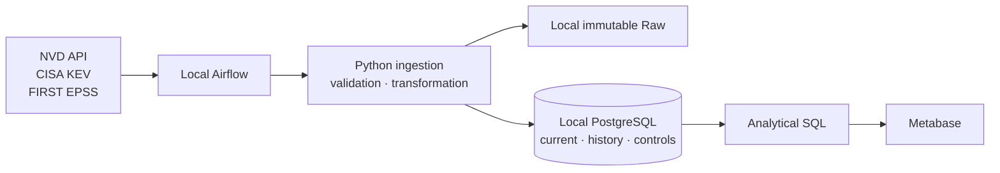
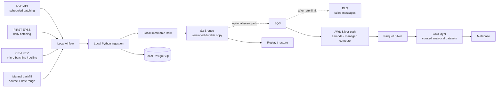
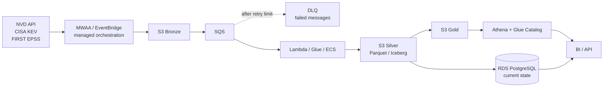
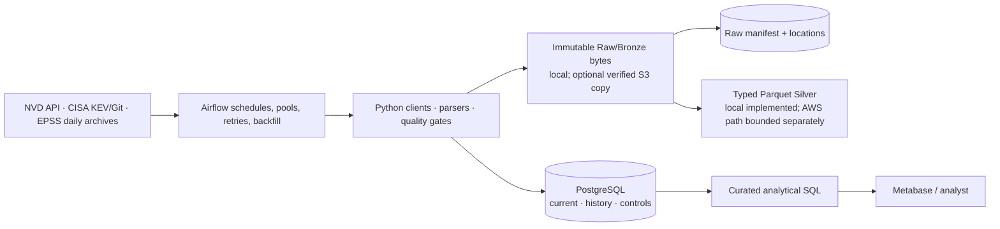

# ThreatFlow project defense

## Key concepts and abbreviations

Terms with a dotted underline have a hover tooltip. Tooltips use HTML `<abbr title="…">`;
if a Markdown viewer strips inline HTML, the definitions remain available in this table.

| Term | Plain-language meaning |
| --- | --- |
| <abbr title="Data Engineering">Data Engineering</abbr> | Designing systems that collect, validate, transform, and serve data. |
| <abbr title="Minimum Viable Product">MVP</abbr> | The smallest project version that already solves the main user problem. |
| <abbr title="National Vulnerability Database">NVD</abbr> | The NIST database providing CVE descriptions, CVSS, CWE context, and references. |
| <abbr title="Cybersecurity and Infrastructure Security Agency">CISA</abbr> | The US government agency that publishes the KEV catalog. |
| <abbr title="Known Exploited Vulnerabilities">KEV</abbr> | CISA's catalog of vulnerabilities known to be exploited in the real world. |
| <abbr title="Forum of Incident Response and Security Teams">FIRST</abbr> | The international incident-response community that publishes EPSS. |
| <abbr title="Exploit Prediction Scoring System">EPSS</abbr> | An estimate of exploitation probability over the next 30 days; it is not complete risk. |
| <abbr title="Common Vulnerabilities and Exposures">CVE</abbr> | A standard public vulnerability identifier, for example `CVE-2026-12345`. |
| <abbr title="Common Vulnerability Scoring System">CVSS</abbr> | A technical severity score; it does not prove exploitation probability or local exposure. |
| <abbr title="Common Weakness Enumeration">CWE</abbr> | A classification of software weakness types, such as SQL injection. |
| <abbr title="Security Operations Center">SOC</abbr> | A team that monitors threats and investigates security incidents. |
| <abbr title="Application Programming Interface">API</abbr> | A formal interface used by the pipeline to request source data. |
| <abbr title="Structured Query Language">SQL</abbr> | The language used to query and transform relational data. |
| <abbr title="Directed Acyclic Graph">DAG</abbr> | Airflow's representation of task order and dependencies. |
| <abbr title="Command-Line Interface">CLI</abbr> | A terminal interface for ingestion, backfill, and verification. |
| <abbr title="Safe repeatability without unintended duplicates or state regression">Idempotency</abbr> | The property that makes ingestion and transformation safe to retry. |
| <abbr title="INSERT-or-UPDATE: create a row or update the existing row for the same key">UPSERT</abbr> | A write that avoids unintended duplicates when a business key is replayed. |
| <abbr title="Combining rows from multiple tables through a shared key">JOIN</abbr> | How NVD, KEV, and EPSS records are correlated by CVE ID. |
| <abbr title="The origin and processing path of data from source to result">Lineage</abbr> | The ability to trace an output to its source payload, request, and pipeline run. |
| <abbr title="Exact immutable source bytes; Bronze is their durable storage layer">Raw / Bronze</abbr> | Source data retained for replay, audit, and failure investigation. |
| <abbr title="Validated typed data after cleaning and normalisation">Silver</abbr> | A prepared reusable layer for processing and analytics. |
| <abbr title="Business-facing datasets and metrics">Gold</abbr> | Final analytical tables, aggregates, or data products. |
| <abbr title="Secure Hash Algorithm with a 256-bit digest">SHA-256</abbr> | A cryptographic fingerprint for artifact identity, integrity, and deduplication. |
| <abbr title="Amazon Simple Storage Service">S3</abbr> | AWS object storage. |
| <abbr title="Amazon Simple Queue Service">SQS</abbr> | A managed AWS message queue. |
| <abbr title="Dead-Letter Queue">DLQ</abbr> | A queue for messages that still fail after their allowed retries. |
| <abbr title="Identity and Access Management">IAM</abbr> | AWS roles and policies that restrict access. |
| <abbr title="Infrastructure as Code">IaC</abbr> | Infrastructure defined and versioned as code, such as Terraform. |
| <abbr title="Business Intelligence">BI</abbr> | Analytics and visualisation tools, represented here by SQL and Metabase. |
| <abbr title="Recovery Point Objective">RPO</abbr> | The maximum acceptable age of recoverable data after a failure. |
| <abbr title="Recovery Time Objective">RTO</abbr> | The target time for restoring the system after a failure. |

## One-minute summary

ThreatFlow is a <abbr title="Data Engineering">data-engineering</abbr> capstone that turns three public but semantically different
cybersecurity sources into a reproducible investigation product. It acquires NVD vulnerability
records, the <abbr title="Cybersecurity and Infrastructure Security Agency">CISA</abbr>
<abbr title="Known Exploited Vulnerabilities">KEV</abbr> catalog, and
<abbr title="Exploit Prediction Scoring System">FIRST EPSS</abbr> daily scores;
preserves exact source bytes; validates completeness and meaning; and publishes an explainable
priority queue through PostgreSQL analytical SQL and Metabase.

The product answers:

> Which <abbr title="Common Vulnerabilities and Exposures">CVEs</abbr> should an analyst investigate first, **if the affected products are present in the
> organisation**?

Additional product questions:

| Question | How ThreatFlow helps answer it |
| --- | --- |
| Which vulnerabilities have confirmed exploitation? | Shows CISA KEV membership, date added, required action, and ransomware context. |
| Which critical CVEs also have a high exploitation probability? | Combines NVD severity with current EPSS and highlights matching records in the priority queue. |
| Which CVEs have a materially rising exploitation signal over the last seven days? | Compares EPSS history and publishes the `WATCH` tier and rising-EPSS output. |
| Which new or changed KEV entries require attention? | Uses CISA snapshots and change history to identify added, modified, and removed events. |
| Why did a CVE receive `P1`, `P2`, `P3`, or `WATCH` priority? | Exposes the contributing NVD, KEV, and EPSS signals and the transparent policy rule. |
| Which CVEs are missing enrichment from one of the sources? | Preserves CVEs through logical left joins and exposes missing NVD, KEV, or EPSS context instead of hiding the row. |
| How fresh and complete is the data behind the queue? | Provides source-freshness, missing-date, cross-source coverage, and integrity indicators. |
| Can the result be traced back to its origin? | Connects analytical output to the source, Raw artifact, SHA-256, request window/date, and processing lineage. |

That qualification is essential. ThreatFlow has no asset inventory, installed-version evidence,
network exposure, business criticality, compensating controls, or remediation status.
<abbr title="Common Vulnerability Scoring System">CVSS</abbr> is technical severity,
<abbr title="Exploit Prediction Scoring System">EPSS</abbr> is estimated exploitation probability,
and <abbr title="Known Exploited Vulnerabilities">KEV</abbr> is evidence of
exploitation in the wild. None proves local exposure.

## Scope, users, and supported decisions

| Persona | Decision or question | ThreatFlow output |
| --- | --- | --- |
| Vulnerability-management analyst | Which CVEs deserve investigation first? | Explainable `P1`, `P2`, `P3`, and `WATCH` queue |
| SOC / threat-intelligence analyst | What is exploited and what signal is rising? | KEV status, ransomware context, EPSS level and trend |
| Security engineer | What is known about a CVE, product, vendor, or weakness? | Searchable NVD context and cross-source joins by CVE ID |
| Incident responder | What public evidence is available for this CVE now? | Unified current NVD, KEV, and EPSS context |
| Data/platform owner | Is the product fresh, complete, and recoverable? | Freshness, coverage, manifest, checkpoint, and quality queries |

In scope are public-data ingestion, immutable Raw evidence, source-aware validation,
incremental/replay-safe loading, orchestration, a relational serving layer, analytical SQL,
dashboards, recovery controls, tests, and documentation. Organisation-specific vulnerability
management and automated remediation are explicitly out of scope.

## Architecture choices considered

The sources are batch-oriented: NVD is a paginated mutable API, CISA publishes an irregular
complete snapshot, and EPSS publishes one complete score set per day. We compared three ways to
deploy the same logical pipeline: fully local, hybrid, and fully on AWS.

| Variant | Shape | Advantages | Disadvantages | Decision |
| --- | --- | --- | --- | --- |
| 1. Fully local development | Sources → local Airflow/Python → local immutable Raw → PostgreSQL → SQL/Metabase | Simplest setup and debugging; low cost; works without cloud access | Raw is tied to one host; weaker disaster recovery and shared access; ingestion and history compete for local resources | Retained as developer mode and a reproducible fallback environment |
| 2. Hybrid pipeline — **selected** | NVD/EPSS batching + CISA micro-batching + manual backfill → local Airflow/Python → local Raw plus S3 Bronze; PostgreSQL holds current state separately, while Parquet Silver → Gold → Metabase | Keeps the simplicity and transactions of the local MVP while adding durable/versioned Raw, replay, and verified S3 restore; supports incremental migration | Two environments require explicit lineage and configuration control; some compute and serving remain local | Best balance of reliability, cost, demonstrability, and already verified deployment for the capstone |
| 3. Fully on AWS | EventBridge/MWAA or managed orchestration → S3 Bronze → SQS/Lambda/Glue/ECS → Parquet/Iceberg Silver/Gold → RDS/Athena/BI | Independent scaling, durable buffering, DLQ, cloud monitoring, and efficient long-term history | Highest IAM, deployment, observability, and cost complexity; requires complete runtime evidence | Target architecture for future scale, not the current capstone deployment |

### Variant 1 — fully local development

### Variant 2 — hybrid pipeline, selected

### Variant 3 — fully on AWS

Hybrid variant 2 was selected. The local side keeps reproducible orchestration, application
services, transactional UPSERTs, and a clear demonstration. S3 Bronze adds a versioned durable
copy of exact source bytes, independent integrity verification, and a restore path. The fully AWS
variant remains a target evolution and should be introduced only after runtime verification and
justification from volume, latency, cost, and reliability requirements. Kafka, Spark, and
Kubernetes are not required for the current source semantics or volume.

## Technology choices

| Technology | Why it belongs |
| --- | --- |
| Python 3.12, HTTPX | Typed, testable source clients, parsers, validation, throttling, and retries |
| SQLAlchemy 2 + Psycopg + Alembic | Explicit models, transaction boundaries, PostgreSQL access, and versioned schema changes |
| PostgreSQL 17 | Reliable unique constraints and conditional UPSERTs, current-state joins, retained history, control data, and small-scale analytics |
| Apache Airflow 3.1, LocalExecutor | Schedules, retries, timeouts, pools, concurrency, dependency control, and visible task state; it does not contain HTTP/SQL business logic |
| Docker Compose | Repeatable local topology and dependency startup without requiring cloud access |
| Metabase + analytical SQL | Read-only, explainable serving layer for analysts; SQL definitions remain reviewable and portable |
| SHA-256 content addressing | Immutable identity, deduplication, integrity verification, and traceability from accepted bytes |
| PyArrow/Parquet | Typed, compressed, partition-friendly Silver files for historical analytics and cloud evolution |
| Terraform | Reviewable, least-privilege AWS infrastructure definitions separated from application code |
| S3, SQS, Lambda, CloudWatch | Deployed only for verified Bronze where stated; otherwise implemented target components for durable object storage, bounded event processing, and operations |
| Pytest, Testcontainers, Ruff | Unit/orchestration regression checks, disposable PostgreSQL integration tests, and static quality checks |

## Inputs: same CVE key, different meanings

| Source | Available Raw data and grain | Change semantics | Important limitation |
| --- | --- | --- | --- |
| NVD CVE API 2.0 | Paginated JSON; one current NVD representation of a CVE, including descriptions, `published`, `lastModified`, CVSS, CWE, references, and configurations | New CVEs and later mutation; daily sync must use `lastModStartDate`/`lastModEndDate`; published and modified backfills are distinct | Nullable/delayed enrichment, rate and 120-day date-window limits, mutable pagination, and no proof of organisational exposure |
| CISA KEV | Complete JSON/CSV catalog with catalog metadata and CVE, vendor/product, date added, action, due date, and ransomware context; official Git mirror provides revisions | Irregular full-snapshot replacement, not an historical snapshot API; content hash or Git commit identifies a revision | Absence is not automatically deletion; vendor/product values are not asset identifiers; KEV does not prove the product exists locally |
| FIRST EPSS | Daily/historical compressed CSV; one CVE probability and percentile per source score date | A complete daily score set; historical key is `(cve_id, score_date)` | Publication can lag; small valid-looking files may be incomplete; model/input changes affect trends; probability is neither impact nor risk |

NVD is the hero dataset because it demonstrates mutable incremental ingestion and recovery.
CISA is the operationally useful fallback: even without enrichment it provides a confirmed-
exploitation queue. EPSS is the time-series enrichment. Joining them is justified because each
answers a different part of the same decision.

## Data flow: Raw/Bronze to Silver and analytics

### 1. Acquisition and immutable evidence

The ingestion service stores exact response bytes before parsing or normalized writes. Local
publication is atomic; the key is `(source, SHA-256)`, so identical retries reuse an artifact and
changed bytes create a new one. `raw_artifacts` records acquisition/request lineage and
`raw_artifact_locations` records independently verified local/S3 copies. Invalid input remains
local diagnostic evidence but is not promoted to accepted S3 Bronze.

### 2. Validation and normalization

- **NVD:** validates schema, CVE identifiers, pages, offsets, stable `totalResults`, duplicates,
  explicit UTC bounds, and source `lastModified`. A complete window is the unit of success.
- **CISA:** rejects malformed or empty catalogs, declared-count mismatches, duplicates, and
  implausible shrinkage against established state. Missing entries are not physically deleted.
- **EPSS:** validates gzip/CSV structure, source date, CVE IDs, duplicates, numeric ranges, and
  conservative date-aware completeness floors/adjacent-day comparisons with an explicit override.

Transformations select a consistent NVD projection (preferred English description, best valid
CVSS version, distinct CWE values, references), preserve CISA remediation/ransomware fields, and
preserve EPSS source date separately from acquisition time.

### 3. Idempotent persistence and integrity

- `nvd_cves` has one latest row per CVE; conditional UPSERT prevents an older `last_modified`
  response from overwriting a newer row.
- `cisa_kev_vulnerabilities` keeps latest accepted entries; `cisa_kev_changes` records baseline,
  added, modified, and removed revision events without destructive snapshot replacement.
- `epss_scores` is unique by `(cve_id, score_date)`; `epss_current` cannot regress to an older
  score date; compact daily summaries remain after detailed retention (30 inclusive days by
  default).
- Cross-source joins are logical by CVE ID, not foreign keys. Different publisher coverage is
  legitimate and missing enrichment must remain visible rather than suppressing a KEV CVE.

Transactions are bounded. Failures propagate to Airflow, normalized work rolls back, and a retry
is safe. No backfill truncates tables.

### 4. Windowing, recovery, and lineage

- NVD daily runs at `03:00 UTC`, resumes from durable `covered_until`, splits long gaps within API
  limits, and advances coverage only after a complete commit. Older gaps use explicit `modified`
  backfill; initial-publication analysis uses the separate `published` mode.
- CISA daily reconciliation runs at `04:00 UTC`; an additive hourly watcher detects changed
  content. The current feed supports one snapshot synchronization, while the official Git history
  supports historical revision processing.
- EPSS daily runs at `06:00 UTC` for the previous source date; missing dates are retried/backfilled
  by exact date.
- `threat_intel_backfill` is manual, validates source/date/mode inputs before requests, chunks
  bounded ranges, and shares source-specific one-slot pools with daily/watch tasks.

Airflow uses `catchup=False`; recovery does not rely on scheduler catchup. Raw hash, request mode,
window bounds, page index, source revision, run ID, record count, and physical location provide
lineage. For Parquet, `source_sha256` and a final manifest connect Silver output to accepted Raw.

## Resulting datasets and analyst use

The serving model contains current NVD/KEV records, recent and current EPSS, permanent EPSS daily
summaries, CISA change events, operational checkpoints, and Raw manifests. Curated SQL produces:

- an explainable priority queue: `P1` (KEV plus high EPSS or ransomware context), `P2` (other KEV),
  `P3` (high/critical CVSS plus high EPSS outside KEV), and `WATCH` (material seven-day EPSS rise);
- CVE search, ransomware subsets, rising EPSS, vendor/product/CWE analysis;
- cross-source coverage, missing-date, freshness, and Raw-integrity indicators.

Example insight: an analyst can find a critical NVD CVE newly present in KEV with a high EPSS
probability and review it before a severity-only CVE. Another CVE can enter `WATCH` because its
EPSS trend rose materially. These are investigation signals, not commands to patch blindly. The
analyst must join them with asset presence, installed version, reachability, criticality, controls,
and remediation state before making an organisation-specific decision. The project tiers are a
documented policy, not an official or universal risk score.

## Operations, governance, security, and reproducibility

### Orchestration and observability

Airflow owns scheduling, retries, timeouts, concurrency, and task state; application modules own
networking and data logic; repositories own transactions. Source-specific pools serialize daily,
watcher, and backfill work. Stage-oriented logs report validation/fetch/chunk/checkpoint/completion
and distinguish fetched from written where available. Airflow state and logs plus SQL freshness,
coverage, and integrity checks provide current observability. A shared cloud dashboard and alarms
are defined in Terraform, but should be described as deployed only after runtime evidence.

### Failure and recovery

Transient HTTP errors use bounded retries. Incomplete NVD pagination cannot advance its checkpoint;
bad CISA/EPSS payloads fail before accepted writes; committed earlier dates/chunks remain valid.
Replay uses Raw bytes and UPSERTs. Exact-byte S3 restore was demonstrated non-invasively. Database
backup scripts validate dumps, but a measured full restore/RPO/RTO drill remains follow-up work.

### Governance and security

The sources contain public vulnerability intelligence and no intended personal data. Source owner,
grain, meaning, terms, limitations, and attribution are documented. `.env` is ignored, examples
contain placeholders, and credentials are injected rather than hardcoded or logged. Application,
Airflow, Metabase metadata, and read-only analytics roles are separated. S3 definitions block
public access, enable encryption/versioning, require TLS, and scope IAM by prefix/action. Adding
asset or incident data would change sensitivity and require explicit access/retention controls.

### Testing and reproducibility

Fixture-based unit tests cover parsing, corruption, completeness, duplicates, retries, windows,
and transformations without production credentials. Airflow-independent tests validate task
adapters and backfill inputs. Testcontainers integration tests exercise PostgreSQL uniqueness,
UPSERTs, stale-update protection, rollback, replay, and migrations in disposable databases. Ruff,
Docker Compose configuration validation, Terraform validation/tests, DAG import checks, and the
safe `scripts/run-capstone-demo.sh` path provide reproducible evidence. A skipped Docker test is
`NOT VERIFIED`, never a pass.

## Limitations and realistic next steps

1. Add a small governed asset-inventory/product-matching model before claiming local exposure or
   organisation-specific prioritisation.
2. Complete and document the one-time legacy invalid CISA S3 object cleanup, preserving recoverable
   versioning semantics.
3. Perform and record full database and Raw restore drills; agree RPO/RTO and retention.
4. Improve run-level metrics for fetched, validated, written, unchanged, rejected, duration, and
   freshness; alert on actionable thresholds.
5. Deploy and verify the existing AWS Silver event paths only if their operational value justifies
   cost; then reconcile every committed Bronze item to a Silver manifest.
6. Move long EPSS/NVD history to partitioned Parquet/Athena or Iceberg only after measured volume
   and query evidence. Keep PostgreSQL for current-state serving.
7. Add CI for lint/unit/integration/IaC checks and a controlled schema-evolution policy.

The main trade-off is intentional: the current solution optimizes correctness, safe recovery,
clarity, and demonstrability before distributed scale.

## 5–10 minute defense narrative

**0:00–0:45 — problem.** ThreatFlow helps a vulnerability or SOC analyst decide what to
investigate first. State immediately that it has no asset inventory and therefore does not prove
local exposure.

**0:45–1:45 — source selection.** NVD gives severity and technical context but mutates; CISA KEV
gives confirmed exploitation as a current snapshot; EPSS gives a daily probability and trend.
Explain why no one signal is a complete risk decision.

**1:45–2:45 — architecture decision.** Show all three variants: fully local, the selected hybrid,
and fully on AWS. In the selected variant, local Airflow orchestrates reusable Python services,
PostgreSQL and Metabase provide current/analytical serving, and exact Raw bytes are stored both
locally and in a verified S3 Bronze copy for durability, replay, and restore. Fully AWS is the
target, not the claimed current deployment.

**2:45–4:00 — difficult engineering.** Walk through one invariant per source: NVD checkpoints only
complete modified windows and rejects stale overwrite; CISA validates complete snapshots and never
blindly deletes; EPSS keys history by source date and rejects implausibly incomplete files. Replays
are safe because storage and database keys are idempotent.

**4:00–5:15 — quality and recovery.** Give the one-row EPSS example: valid CSV syntax is not enough.
Show how failures retain Raw evidence, roll back normalized writes, fail the Airflow task, and allow
exact-date/window replay. Mention pools, bounded retries, and manual backfill.

**5:15–6:30 — product.** Show the priority queue or analytical SQL. Explain one row by tracing NVD,
KEV, and EPSS contributions. Repeat that tiers are transparent project policy and require local
asset context.

**6:30–7:30 — evidence and status.** Point to fixture tests, disposable PostgreSQL integration
tests, DAG parsing, the reproducible demo, and dated S3 Bronze/restore evidence. Clearly label AWS
Silver as implemented but not claimed end-to-end deployed.

**7:30–8:00 — judgement.** Close with the next two steps: add governed asset context and prove
restore/metrics. Scale historical storage only from measured need.

## Likely curator questions

**Why three sources?**  
They are complementary: NVD describes technical severity/context, CISA confirms exploitation, and
EPSS estimates probability/trend. None alone supports the investigation decision as well.

**Why PostgreSQL rather than a warehouse?**  
At this scale PostgreSQL gives transactional conditional UPSERTs, unique constraints, fast joins,
and a locally reproducible serving layer. Columnar history is an evidence-driven next step.

**Why Airflow if each source has only one main task?**  
It provides schedules, retries, timeouts, pools, run state, logs, and a parameterized recovery path.
The source logic remains independently testable and executable, so orchestration is not lock-in.

**Is this streaming?**  
No. The publishers expose an API, snapshots, and daily files. Even the CISA watcher is polling;
events begin only after a changed internal artifact is accepted.

**How are duplicates and stale data prevented?**  
Raw uses source/SHA-256 identity; business tables have unique keys and UPSERTs; NVD compares
`lastModified`; EPSS current state compares score date; CISA changes use revision/CVE identity.

**What happens after a long outage?**  
NVD resumes from its durable successful boundary and uses `modified` backfill for older gaps. EPSS
backfills exact missing score dates. CISA keeps the last valid current state and reconciles from a
fresh snapshot or official Git revisions.

**Why no foreign keys between source CVE tables?**  
Publishers legitimately differ in scope and timing. A missing enrichment is information, not an
invalid row; logical left joins preserve confirmed KEV entries.

**How do you know a payload is complete?**  
Completeness is source-specific: stable NVD pagination totals, CISA declared counts and shrinkage
checks, and EPSS date-aware population/anomaly rules. Syntax alone is never treated as success.

**What exactly runs in AWS?**  
Dated evidence confirms development S3 Bronze replication and restore for all three sources. The
Silver handlers and Terraform topology are implemented/tested, but their end-to-end deployment is
not claimed; the full lakehouse is target architecture.

**What is the biggest product limitation?**  
No organisation asset/exposure context. The queue prioritizes public intelligence for
investigation; it cannot determine whether a particular environment is vulnerable.

## Evidence map

- [Capstone report](capstone-report.md)
- [Dataset assessment](dataset-assessment.md)
- [Data catalog](data-catalog.md)
- [Data model](data-model.md)
- [Architecture study](data-pipeline-treatflow.md)
- [Governance and responsible use](governance.md)
- [Failure and recovery demonstration](failure-recovery-demo.md)
- [S3 Bronze runtime verification](bronze-verification.md)
- [Vulnerability prioritisation policy](vulnerability-prioritization.en.md)
- [AWS infrastructure guide](../infra/README.md)

