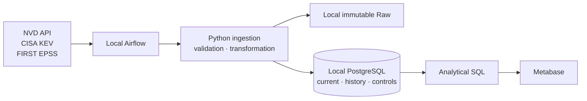
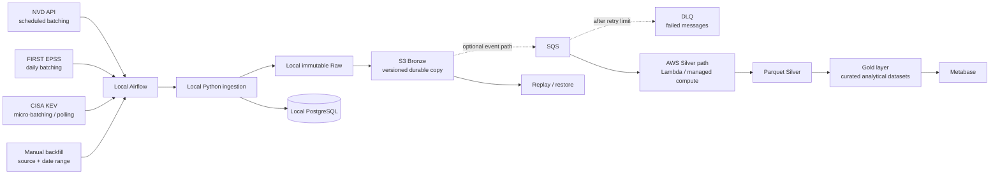
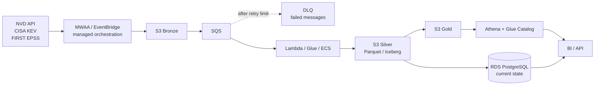
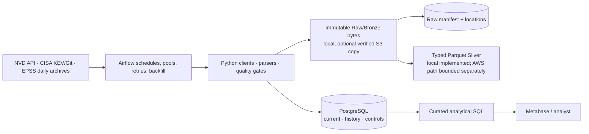

# Защита проекта ThreatFlow

## Основные понятия и сокращения

Термины с пунктирным подчёркиванием имеют всплывающую подсказку при наведении. Подсказки
реализованы через HTML `<abbr title="…">`; если Markdown-просмотрщик не поддерживает их,
расшифровки остаются доступны в таблице.

| Термин | Расшифровка простыми словами |
| --- | --- |
| <abbr title="Data Engineering — инженерия данных">Data Engineering</abbr> | Проектирование систем, которые собирают, проверяют, преобразуют и предоставляют данные. |
| <abbr title="Minimum Viable Product — минимально жизнеспособный продукт">MVP</abbr> | Минимальная версия проекта, уже решающая основную пользовательскую задачу. |
| <abbr title="National Vulnerability Database">NVD</abbr> | База NIST с описаниями CVE, оценками CVSS, CWE и ссылками. |
| <abbr title="Cybersecurity and Infrastructure Security Agency">CISA</abbr> | Государственное агентство США, публикующее каталог KEV. |
| <abbr title="Known Exploited Vulnerabilities">KEV</abbr> | Каталог уязвимостей с подтверждённой эксплуатацией. |
| <abbr title="Forum of Incident Response and Security Teams">FIRST</abbr> | Международное сообщество команд реагирования, публикующее EPSS. |
| <abbr title="Exploit Prediction Scoring System">EPSS</abbr> | Оценка вероятности эксплуатации CVE в ближайшие 30 дней; не полный risk score. |
| <abbr title="Common Vulnerabilities and Exposures">CVE</abbr> | Стандартный идентификатор публичной уязвимости, например `CVE-2026-12345`. |
| <abbr title="Common Vulnerability Scoring System">CVSS</abbr> | Оценка технической тяжести; сама по себе не доказывает вероятность эксплуатации или локальную экспозицию. |
| <abbr title="Common Weakness Enumeration">CWE</abbr> | Классификатор типов программных слабостей, например SQL injection. |
| <abbr title="Security Operations Center">SOC</abbr> | Команда мониторинга угроз и расследования инцидентов безопасности. |
| <abbr title="Application Programming Interface">API</abbr> | Программный интерфейс, через который pipeline запрашивает данные источника. |
| <abbr title="Structured Query Language">SQL</abbr> | Язык запросов и преобразований реляционных данных. |
| <abbr title="Directed Acyclic Graph">DAG</abbr> | Описание порядка и зависимостей задач в Airflow. |
| <abbr title="Command-Line Interface">CLI</abbr> | Интерфейс командной строки для ingestion, backfill и проверок. |
| <abbr title="Безопасная повторяемость операции без случайных дублей или регрессии состояния">Идемпотентность</abbr> | Свойство, позволяющее безопасно повторить ingestion или transformation. |
| <abbr title="INSERT-or-UPDATE — создать строку или обновить существующую по ключу">UPSERT</abbr> | Запись, не создающая случайный дубль при повторной обработке business key. |
| <abbr title="Связывание строк нескольких таблиц по общему ключу">JOIN</abbr> | Объединение NVD, KEV и EPSS по CVE ID. |
| <abbr title="Происхождение данных и путь их обработки от источника до результата">Lineage</abbr> | Возможность проследить результат до source payload, запроса и запуска pipeline. |
| <abbr title="Точные неизменяемые байты источника; Bronze — слой их долговременного хранения">Raw / Bronze</abbr> | Исходные данные для replay, audit и расследования ошибок. |
| <abbr title="Проверенные типизированные данные после очистки и нормализации">Silver</abbr> | Подготовленный слой для повторного использования и аналитики. |
| <abbr title="Готовые бизнес-ориентированные datasets и метрики">Gold</abbr> | Конечные аналитические таблицы, агрегаты или data products. |
| <abbr title="Secure Hash Algorithm с 256-битным digest">SHA-256</abbr> | Криптографический отпечаток для identity, integrity и дедупликации artifact. |
| <abbr title="Amazon Simple Storage Service">S3</abbr> | Объектное хранилище AWS. |
| <abbr title="Amazon Simple Queue Service">SQS</abbr> | Управляемая очередь сообщений AWS. |
| <abbr title="Dead-Letter Queue">DLQ</abbr> | Очередь сообщений, которые не удалось обработать после повторных попыток. |
| <abbr title="Identity and Access Management">IAM</abbr> | Роли и политики доступа AWS. |
| <abbr title="Infrastructure as Code">IaC</abbr> | Инфраструктура, описанная и версионируемая как код, например Terraform. |
| <abbr title="Business Intelligence">BI</abbr> | Инструменты аналитики и визуализации, в проекте — SQL и Metabase. |
| <abbr title="Recovery Point Objective — допустимая потеря данных по времени">RPO</abbr> | Насколько старой может быть последняя восстановимая копия. |
| <abbr title="Recovery Time Objective — допустимое время восстановления">RTO</abbr> | За какое время система должна восстановиться после аварии. |

## Резюме на одну минуту

ThreatFlow — итоговый проект по <abbr title="Data Engineering — инженерия данных">Data Engineering</abbr>, который превращает три публичных, но
семантически разных источника киберразведки в воспроизводимый аналитический продукт. Система
загружает данные <abbr title="National Vulnerability Database">NVD</abbr>, каталог
<abbr title="Cybersecurity and Infrastructure Security Agency">CISA</abbr>
<abbr title="Known Exploited Vulnerabilities">KEV</abbr> и ежедневные оценки
<abbr title="Exploit Prediction Scoring System">FIRST EPSS</abbr>, сохраняет точные исходные
байты, проверяет полноту и смысл данных и публикует объяснимую очередь для расследования через
аналитический <abbr title="Structured Query Language">SQL</abbr> в PostgreSQL и Metabase.

Главный вопрос продукта:

> Какие <abbr title="Common Vulnerabilities and Exposures">CVE</abbr> аналитик должен исследовать в первую очередь, **если затронутые продукты
> присутствуют в инфраструктуре организации**?

Дополнительные продуктовые вопросы:

| Вопрос | Как ThreatFlow помогает ответить |
| --- | --- |
| Какие уязвимости имеют подтверждённую эксплуатацию? | Показывает членство в CISA KEV, дату добавления, required action и ransomware context. |
| Какие критичные CVE имеют высокую вероятность эксплуатации? | Объединяет NVD severity с текущей оценкой EPSS и выделяет соответствующие записи в priority queue. |
| У каких CVE заметно вырос сигнал эксплуатации за последние семь дней? | Сравнивает историю EPSS и формирует категорию `WATCH` и rising-EPSS выборку. |
| Какие новые или изменившиеся KEV требуют внимания? | Использует CISA snapshots/change history для выявления added, modified и removed events. |
| Почему конкретная CVE получила приоритет `P1`, `P2`, `P3` или `WATCH`? | Показывает исходные сигналы NVD, KEV и EPSS и применённое прозрачное policy rule. |
| Для каких CVE не хватает enrichment из одного из источников? | Сохраняет CVE через logical left joins и показывает отсутствие NVD, KEV или EPSS вместо скрытия записи. |
| Насколько свежи и полны данные, на которых основана очередь? | Предоставляет source freshness, missing-date, cross-source coverage и integrity indicators. |
| Можно ли восстановить происхождение результата? | Связывает аналитическую запись с source, Raw artifact, SHA-256, request window/date и processing lineage. |

Эта оговорка принципиальна. В ThreatFlow нет инвентаризации активов, подтверждения установленных
версий, сетевой доступности, бизнес-критичности, компенсирующих мер и статуса исправления.
<abbr title="Common Vulnerability Scoring System">CVSS</abbr> показывает техническую тяжесть,
<abbr title="Exploit Prediction Scoring System">EPSS</abbr> — оценочную вероятность эксплуатации,
а <abbr title="Known Exploited Vulnerabilities">KEV</abbr> — факт
эксплуатации в реальном мире. Ни один из этих сигналов не доказывает локальную уязвимость.

## Границы, пользователи и поддерживаемые решения

| Персона | Решение или вопрос | Результат ThreatFlow |
| --- | --- | --- |
| Аналитик vulnerability management | Какие CVE исследовать первыми? | Объяснимая очередь `P1`, `P2`, `P3`, `WATCH` |
| SOC / threat-intelligence аналитик | Что уже эксплуатируется и где растёт сигнал? | KEV, контекст ransomware, уровень и тренд EPSS |
| Security engineer | Что известно о CVE, продукте, вендоре или типе слабости? | Поиск по NVD и объединение источников по CVE ID |
| Incident responder | Какие публичные сведения сейчас есть о CVE? | Единый актуальный контекст NVD, KEV и EPSS |
| Владелец данных/платформы | Свежи, полны и восстанавливаемы ли данные? | Проверки свежести, покрытия, манифестов, checkpoint и качества |

В scope входят загрузка публичных данных, неизменяемый Raw-слой, проверки с учётом семантики
источника, инкрементальная и безопасная повторная загрузка, оркестрация, реляционный serving layer,
аналитический SQL, дашборды, восстановление, тесты и документация. Определение уязвимости
конкретной организации и автоматическое исправление явно не входят в scope.

## Рассмотренные варианты архитектуры

Источники по природе пакетные: NVD — изменяемый API с пагинацией, CISA — нерегулярный полный
снимок, EPSS — один полный набор оценок в день. Мы сравнили три способа разместить один и тот же
логический pipeline: полностью локально, гибридно и полностью в AWS.

| Вариант | Схема | Преимущества | Недостатки | Решение |
| --- | --- | --- | --- | --- |
| 1. Полностью локальная разработка | Источники → локальный Airflow/Python → локальный immutable Raw → PostgreSQL → SQL/Metabase | Самый простой запуск и отладка; низкая стоимость; работа без cloud access | Raw привязан к одному хосту; слабее disaster recovery и совместный доступ; история и ingestion конкурируют за локальные ресурсы | Сохранён как developer mode и воспроизводимая fallback-среда |
| 2. Гибридный pipeline — **выбран** | NVD/EPSS batching + CISA micro-batching + manual backfill → локальный Airflow/Python → локальный Raw + S3 Bronze; PostgreSQL хранит current state отдельно, а Parquet Silver → Gold → Metabase | Сохраняет простоту и транзакционность локального MVP, но добавляет durable/versioned Raw, replay и проверяемое восстановление из S3; миграция выполняется поэтапно | Две среды требуют явного lineage и контроля конфигурации; часть compute и serving остаётся привязана к локальной платформе | Лучший баланс надёжности, стоимости, демонстрируемости и уже подтверждённого deployment для capstone |
| 3. Полностью AWS | EventBridge/MWAA или managed orchestration → S3 Bronze → SQS/Lambda/Glue/ECS → Parquet/Iceberg Silver/Gold → RDS/Athena/BI | Независимое масштабирование, durable buffering, DLQ, cloud monitoring и эффективная многолетняя история | Максимальная сложность IAM, deployment, observability и стоимость; требует полного runtime evidence | Целевая архитектура для будущего масштаба, не текущий deployment capstone |

### Вариант 1 — полностью локальная разработка

### Вариант 2 — гибридный pipeline, выбран

### Вариант 3 — полностью AWS

Выбран гибридный вариант 2. Локальная часть сохраняет воспроизводимую оркестрацию, application
services, транзакционные UPSERT и понятную демонстрацию. S3 Bronze добавляет versioned durable
copy точных исходных байтов, независимую проверку integrity и путь восстановления. Полностью AWS
вариант остаётся целевым развитием: его компоненты можно вводить только после runtime-проверки и
обоснования объёмом, latency, стоимостью и требованиями надёжности. Kafka, Spark и Kubernetes при
текущей семантике и объёме источников не нужны.

## Выбор технологий

| Технология | Зачем она нужна |
| --- | --- |
| Python 3.12, HTTPX | Типизированные и тестируемые clients, parsers, validation, throttling и retries |
| SQLAlchemy 2 + Psycopg + Alembic | Модели, границы транзакций, PostgreSQL и версионируемые migrations |
| PostgreSQL 17 | Unique constraints, conditional UPSERT, current-state JOIN, история, control data и аналитика малого масштаба |
| Apache Airflow 3.1, LocalExecutor | Schedules, retries, timeouts, pools, concurrency, dependencies и видимый task state; HTTP/SQL business logic остаётся вне DAG |
| Docker Compose | Повторяемая локальная топология без обязательного cloud access |
| Metabase + аналитический SQL | Read-only и объяснимый serving layer; определения метрик остаются обозримыми и переносимыми |
| Content addressing по SHA-256 | Неизменяемая идентичность, дедупликация, integrity verification и трассировка исходных байтов |
| PyArrow/Parquet | Типизированный сжатый Silver для partitioning, истории и cloud-эволюции |
| Terraform | Проверяемые least-privilege AWS definitions отдельно от application code |
| S3, SQS, Lambda, CloudWatch | Для Bronze — только там, где deployment подтверждён; в остальных случаях реализованные target-компоненты хранения, bounded event processing и operations |
| Pytest, Testcontainers, Ruff | Unit/orchestration regression, disposable PostgreSQL integration и static checks |

## Входные данные: общий ключ CVE, разная семантика

| Источник | Доступный Raw и grain | Семантика изменений | Важное ограничение |
| --- | --- | --- | --- |
| NVD CVE API 2.0 | Paginated JSON; текущее представление одного CVE: descriptions, `published`, `lastModified`, CVSS, CWE, references, configurations | Новые CVE и последующие изменения; daily sync использует `lastModStartDate`/`lastModEndDate`; published и modified backfill различаются | Nullable/delayed enrichment, rate limit и окно 120 дней, изменяемая пагинация, нет доказательства локальной экспозиции |
| CISA KEV | Полный JSON/CSV catalog с metadata, CVE, vendor/product, date added, action, due date, ransomware; официальный Git mirror содержит revisions | Нерегулярная замена полного snapshot, а не historical snapshot API; revision определяется content hash или Git commit | Отсутствие не означает автоматическое удаление; vendor/product не asset identifiers; KEV не доказывает наличие продукта локально |
| FIRST EPSS | Daily/historical compressed CSV; вероятность и percentile для CVE на source score date | Полный ежедневный набор; historical key — `(cve_id, score_date)` | Возможна задержка публикации; маленький синтаксически валидный файл может быть неполным; изменения модели/входов влияют на trend; probability не равна impact или risk |

NVD — hero dataset, потому что показывает изменяемый incremental ingestion и recovery. CISA —
полезный operational fallback: даже без enrichment он даёт очередь подтверждённо эксплуатируемых
уязвимостей. EPSS — time-series enrichment. Их объединение оправдано: каждый источник отвечает на
отдельную часть одного решения.

## Поток данных: от Raw/Bronze к Silver и аналитике

### 1. Acquisition и неизменяемое доказательство

Ingestion service сохраняет точные response bytes до parsing и normalized writes. Локальная
публикация атомарна; ключ `(source, SHA-256)` повторно использует одинаковый artifact при retry, а
изменённые байты создают новый. `raw_artifacts` хранит acquisition/request lineage,
`raw_artifact_locations` — независимо проверенные local/S3 copies. Невалидные данные остаются
локальным diagnostic evidence, но не продвигаются в accepted S3 Bronze.

### 2. Validation и normalization

- **NVD:** проверяются schema, CVE ID, pages, offsets, стабильный `totalResults`, duplicates, явные
  UTC bounds и source `lastModified`. Единица успеха — полное window.
- **CISA:** отклоняются malformed/empty catalog, count mismatch, duplicates и неправдоподобное
  shrinkage относительно установленного состояния. Отсутствующие записи физически не удаляются.
- **EPSS:** проверяются gzip/CSV, source date, CVE ID, duplicates, numeric ranges и консервативные
  date-aware completeness floors/сравнения соседних дней с явным override.

Transformations выбирают согласованную NVD projection (предпочтительно English description,
лучшая валидная версия CVSS, distinct CWE, references), сохраняют CISA remediation/ransomware и
отделяют EPSS source date от acquisition time.

### 3. Идемпотентная запись и целостность

- `nvd_cves` хранит последнюю строку на CVE; conditional UPSERT не позволяет старому
  `last_modified` перезаписать новую версию.
- `cisa_kev_vulnerabilities` хранит последние принятые записи; `cisa_kev_changes` фиксирует
  baseline, added, modified и removed events без destructive snapshot replacement.
- `epss_scores` уникален по `(cve_id, score_date)`; `epss_current` не регрессирует к старой дате;
  компактные daily summaries сохраняются после detailed retention (по умолчанию 30 включительных
  source dates).
- Межисточниковые связи — logical JOIN по CVE ID, а не foreign keys. Разное покрытие publishers
  нормально; отсутствие enrichment должно быть видно и не должно скрывать KEV CVE.

Транзакции ограничены. Ошибки доходят до Airflow, normalized writes откатываются, retry безопасен.
Backfill никогда не использует truncate.

### 4. Windowing, recovery и lineage

- NVD daily запускается в `03:00 UTC`, продолжает с durable `covered_until`, делит длинные gaps по
  API limits и продвигает coverage только после полного commit. Старые gaps требуют явного
  `modified` backfill; анализ первичной публикации использует отдельный `published` mode.
- CISA daily reconciliation запускается в `04:00 UTC`; дополнительный hourly watcher обнаруживает
  новый content. Current feed поддерживает один snapshot sync, а официальный Git history —
  обработку historical revisions.
- EPSS daily запускается в `06:00 UTC` для предыдущей source date; отсутствующие даты повторяются
  или backfill по точной дате.
- `threat_intel_backfill` — manual DAG; он валидирует source/date/mode до request, делит ranges на
  bounded chunks и делит one-slot source pools с daily/watcher tasks.

Airflow использует `catchup=False`; recovery не полагается на scheduler catchup. Raw hash, request
mode, window bounds, page index, source revision, run ID, record count и physical location дают
lineage. В Parquet поля `source_sha256` и финальный manifest связывают Silver с accepted Raw.

## Результирующие datasets и работа аналитика

Serving model содержит current NVD/KEV, recent/current EPSS, постоянные EPSS daily summaries, CISA
change events, operational checkpoints и Raw manifests. Curated SQL формирует:

- объяснимую priority queue: `P1` (KEV плюс высокий EPSS или ransomware), `P2` (остальные KEV),
  `P3` (high/critical CVSS плюс высокий EPSS вне KEV), `WATCH` (существенный рост EPSS за 7 дней);
- CVE search, ransomware subsets, rising EPSS, vendor/product/CWE analysis;
- cross-source coverage, missing dates, freshness и Raw-integrity indicators.

Например, аналитик может найти critical NVD CVE, недавно попавшую в KEV и имеющую высокий EPSS, и
исследовать её раньше уязвимости, выбранной только по severity. Другая CVE может войти в `WATCH`
из-за заметного роста EPSS. Это сигналы для расследования, а не команда немедленно устанавливать
patch. Для решения нужны asset presence, installed version, reachability, criticality, controls и
remediation state. Проектные tiers — документированная policy, а не официальный universal risk
score.

## Operations, governance, security и воспроизводимость

### Orchestration и observability

Airflow отвечает за schedule, retry, timeout, concurrency и task state; application modules — за
networking и data logic; repositories — за transactions. Source pools сериализуют daily, watcher и
backfill. Stage-oriented logs показывают validation/fetch/chunk/checkpoint/completion и, где
возможно, различают fetched и written. Airflow state/logs и SQL-проверки freshness, coverage и
integrity обеспечивают текущую observability. Cloud dashboard и alarms определены в Terraform, но
их следует называть deployed только после runtime evidence.

### Failure и recovery

Transient HTTP errors получают bounded retry. Неполная NVD pagination не двигает checkpoint;
плохие CISA/EPSS payloads завершаются до accepted writes; ранее committed dates/chunks остаются
валидными. Replay использует Raw bytes и UPSERT. Exact-byte restore из S3 продемонстрирован без
изменения manifest. Backup scripts проверяют dumps, но измеренный full restore и RPO/RTO остаются
следующим шагом.

### Governance и security

Источники содержат публичную vulnerability intelligence без предполагаемых персональных данных.
Задокументированы owner, grain, meaning, terms, limitations и attribution. `.env` исключён из Git,
examples содержат placeholders, credentials передаются через configuration и не логируются. Роли
application, Airflow, Metabase metadata и read-only analytics разделены. S3 definitions блокируют
public access, включают encryption/versioning, требуют TLS и ограничивают IAM по prefix/action.
Добавление asset/incident data изменит чувствительность и потребует явных access/retention rules.

### Testing и reproducibility

Fixture-based unit tests покрывают parsing, corruption, completeness, duplicates, retries, windows
и transformations без production credentials. Airflow-independent tests проверяют adapters и
backfill inputs. Testcontainers integration tests в disposable PostgreSQL проверяют uniqueness,
UPSERT, stale-update protection, rollback, replay и migrations. Ruff, Docker Compose config,
Terraform validation/tests, DAG import checks и безопасный `scripts/run-capstone-demo.sh` дают
воспроизводимые доказательства. Skipped Docker test — это `NOT VERIFIED`, а не pass.

## Ограничения и реалистичные следующие шаги

1. Добавить небольшой governed asset-inventory/product-matching model до заявлений о local exposure
   или organisation-specific prioritisation.
2. Завершить и описать one-time cleanup legacy invalid CISA S3 object, сохранив recoverable
   versioning semantics.
3. Провести full database и Raw restore drills, согласовать RPO/RTO и retention.
4. Улучшить run-level metrics: fetched, validated, written, unchanged, rejected, duration,
   freshness; добавить alerts с осмысленными thresholds.
5. Разворачивать и проверять существующие AWS Silver event paths только если их ценность оправдывает
   стоимость; затем reconcile каждый committed Bronze item с Silver manifest.
6. Переносить длинную EPSS/NVD history в partitioned Parquet/Athena или Iceberg только после
   измерения объёма и queries; PostgreSQL оставить для current-state serving.
7. Добавить CI для lint/unit/integration/IaC и контролируемую schema-evolution policy.

Главный trade-off выбран сознательно: сначала correctness, safe recovery, понятность и
демонстрируемость, затем distributed scale.

## Сценарий защиты на 5–10 минут

**0:00–0:45 — проблема.** ThreatFlow помогает vulnerability/SOC analyst выбрать, что исследовать
первым. Сразу сказать: без asset inventory продукт не доказывает local exposure.

**0:45–1:45 — выбор источников.** NVD даёт severity и technical context, но записи меняются; CISA
KEV подтверждает exploitation и является current snapshot; EPSS даёт daily probability и trend.
Ни один сигнал не является полным risk decision.

**1:45–2:45 — архитектурное решение.** Показать три варианта: полностью локальный, выбранный
гибридный и полностью AWS. В выбранном варианте локальный Airflow оркестрирует reusable Python
services, PostgreSQL и Metabase обслуживают current/analytical слой, а exact Raw bytes сохраняются
локально и в проверенной S3 Bronze copy для durability, replay и restore. Полностью AWS — target,
а не заявленный текущий deployment.

**2:45–4:00 — сложная инженерия.** По одному invariant на источник: NVD checkpoint фиксирует только
полные modified windows и не допускает stale overwrite; CISA проверяет полный snapshot и не удаляет
вслепую; EPSS хранит history по source date и отклоняет неправдоподобно маленькие файлы. Replay
безопасен благодаря idempotent storage/database keys.

**4:00–5:15 — качество и recovery.** Пример EPSS из одной строки: корректный CSV ещё не означает
полный dataset. Ошибка сохраняет Raw evidence, откатывает normalized writes, завершает Airflow task
как failed и допускает replay точной date/window. Упомянуть pools, bounded retries и manual backfill.

**5:15–6:30 — продукт.** Показать priority queue или SQL. Разобрать одну строку по сигналам NVD,
KEV и EPSS. Повторить: tiers прозрачны, но требуют локального asset context.

**6:30–7:30 — доказательства и статусы.** Показать fixture tests, disposable PostgreSQL integration,
DAG parsing, reproducible demo и dated S3 Bronze/restore evidence. AWS Silver явно назвать
implemented, но не end-to-end deployed.

**7:30–8:00 — инженерное решение.** Завершить двумя шагами: governed asset context и доказанный
restore/metrics. Масштабировать историческое хранение только по измеренной необходимости.

## Вероятные вопросы куратора

**Зачем три источника?**  
Они дополняют друг друга: NVD описывает severity/context, CISA подтверждает exploitation, EPSS
оценивает probability/trend. Вместе они лучше поддерживают решение об исследовании.

**Почему PostgreSQL, а не warehouse?**  
При текущем масштабе PostgreSQL даёт conditional UPSERT, unique constraints, быстрые JOIN и
воспроизводимый serving layer. Columnar history — следующий шаг по измеренным данным.

**Зачем Airflow, если на источник приходится одна основная task?**  
Он даёт schedules, retries, timeouts, pools, run state, logs и parameterized recovery. Source logic
остаётся независимо тестируемой и запускаемой, поэтому оркестратор не создаёт lock-in.

**Это streaming?**  
Нет. Publishers предоставляют API, snapshots и daily files. Даже CISA watcher использует polling;
events начинаются только после принятия изменившегося внутреннего artifact.

**Как предотвращаются duplicates и stale data?**  
Raw уникален по source/SHA-256; business tables имеют unique keys и UPSERT; NVD сравнивает
`lastModified`; EPSS current сравнивает score date; CISA changes уникальны по revision/CVE.

**Что произойдёт после долгого outage?**  
NVD продолжит с durable successful boundary и использует `modified` backfill для старых gaps. EPSS
загрузит точные missing score dates. CISA сохранит last valid current state и восстановится из
свежего snapshot или official Git revisions.

**Почему между source tables нет foreign keys по CVE?**  
Publishers различаются по scope и времени. Missing enrichment — это информация, а не invalid row;
logical left joins сохраняют подтверждённые KEV entries.

**Как доказать полноту payload?**  
Проверка специфична для источника: стабильный NVD pagination total, CISA declared count и shrinkage,
EPSS date-aware population/anomaly rules. Одного корректного синтаксиса недостаточно.

**Что именно работает в AWS?**  
Датированное evidence подтверждает dev S3 Bronze replication и restore для трёх источников. Silver
handlers и Terraform topology реализованы/протестированы, но их end-to-end deployment не заявлен;
полный lakehouse — target architecture.

**Главное ограничение продукта?**  
Нет контекста assets/exposure организации. Очередь приоритизирует публичные сигналы для
расследования, но не определяет уязвимость конкретной среды.

## Карта доказательств

- [Итоговый capstone report](capstone-report.md)
- [Оценка datasets](dataset-assessment.md)
- [Data catalog](data-catalog.md)
- [Data model](data-model.md)
- [Architecture study](data-pipeline-treatflow.md)
- [Governance и responsible use](governance.md)
- [Failure and recovery demonstration](failure-recovery-demo.md)
- [S3 Bronze runtime verification](bronze-verification.md)
- [Vulnerability prioritisation policy](vulnerability-prioritization.en.md)
- [AWS infrastructure guide](../infra/README.md)

